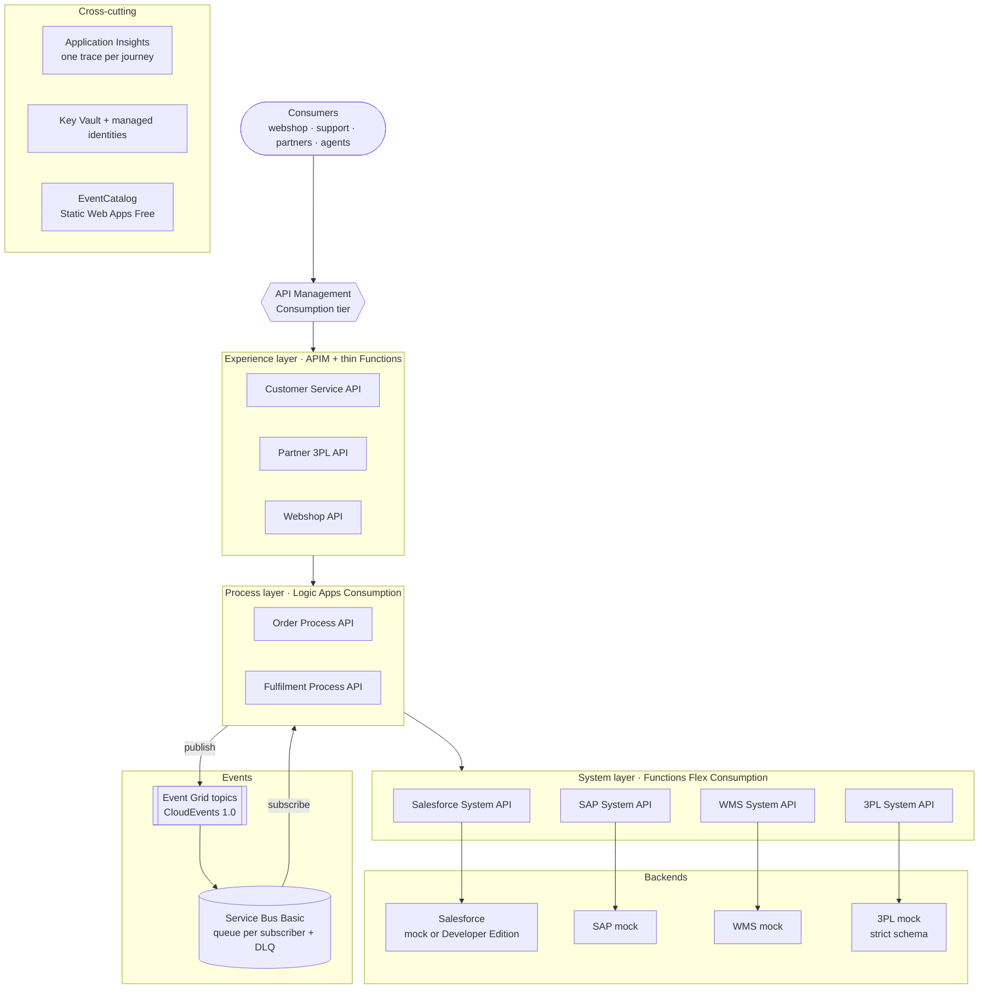
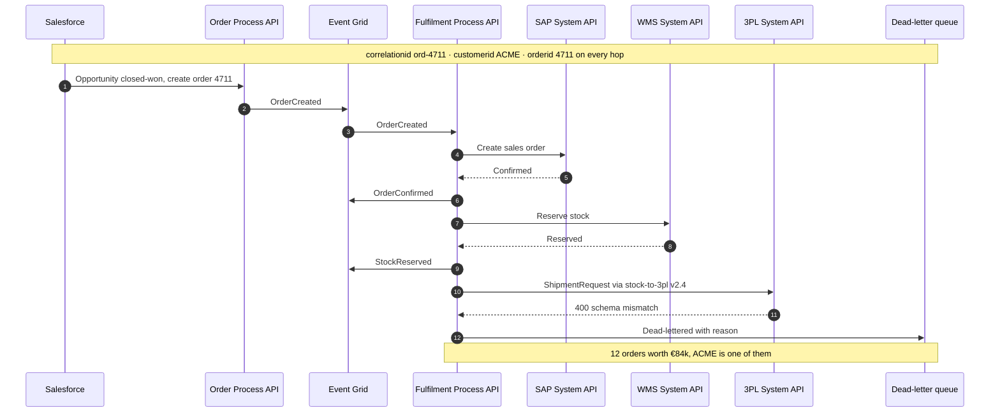

# AI Intelligence Domain — demo

A demo of the talk **"AI as a new architectural domain"**
(Nordic APIs Summit 2026, Axel Vuylsteke — The Value Hub), built on Azure.

> Every system knows its part. None knows the story.
> Your integration platform already sees every hand-off.

The demo replays one business journey, **ACME's order 4711**, through an
integration platform (Salesforce → SAP → Warehouse → 3PL). Later, an
**Intelligence domain** subscribes to everything the platform sees and answers
questions no single system can answer, such as *"Where is ACME's order
4711?"*, with cited evidence.

## Scope

- **Demo / reference only.** Not production.
- **Azure**, region Belgium Central (West Europe as fallback per service).
- **Consumption tiers only.** Hard ceiling of **€10/month**, enforced by a
  budget and a kill switch ([ADR 0003](docs/adr/0003-azure-consumption-with-cost-cap.md)).
- **API-led and composable** ([ADR 0004](docs/adr/0004-api-led-composable.md)).
- **Contracts on everything**, documented in EventCatalog
  ([ADR 0005](docs/adr/0005-contracts-everywhere-eventcatalog.md)).

## Phase 1 — Integration platform

*No solid platform? No intelligence!*

| Step | What | Status |
|---|---|---|
| 0 | Repo structure, rules, decision log | ✅ |
| 1 | Foundation: Azure subscription, budget + kill switch, GitHub repo, OIDC | ⏳ |
| 2 | Envelope contract: CloudEvents + `correlationid`, `customerid`, `orderid` | ⏳ |
| 3 | Contract tooling: linting, breaking-change checks, EventCatalog | ⏳ |
| 4 | Platform core (Bicep): API Management, Event Grid, Service Bus, App Insights, Key Vault | ⏳ |
| 5 | First vertical slice: Salesforce System API → Order Process API → `OrderCreated`, one trace | ⏳ |
| 6 | SAP, WMS, 3PL System APIs and the Fulfilment Process API | ⏳ |
| 7 | Experience APIs | ⏳ |
| 8 | The v2.4 break: faulty `stock-to-3pl` mapping, dead letters arrive | ⏳ |

## Phase 2 — Intelligence domain

Tap, ingest, understand, remember, reason, expose (MCP). Planned after phase 1;
cost decisions per service.

## Architecture (phase 1)

| Layer | Building blocks | Azure service |
|---|---|---|
| Gateway | All APIs exposed through one gateway | API Management (Consumption) |
| Experience | Customer Service, Partner (3PL), Webshop | API Management (+ thin Functions) |
| Process | Order, Fulfilment | Logic Apps (Consumption) |
| System | Salesforce, SAP, WMS, 3PL | Functions (Flex Consumption, Python) |
| Events | Business events between domains | Event Grid → Service Bus Basic queue per subscriber (with DLQ) |
| Backends | SAP, WMS, 3PL mocks; Salesforce mock or Developer Edition | Functions |
| Observability | One trace per journey | Application Insights + Log Analytics |
| Secrets & identity | No secrets in code | Key Vault, managed identities |
| Catalog | Domains, services, events, contracts, owners | EventCatalog on Static Web Apps (Free) |

Region availability per service is verified at step 4 and noted here.

### API-led layers

Every call between layers goes through API Management. Hand-offs between
domains are events.



### The ACME 4711 journey

What the platform sees for one order. After deployment v2.4 of
`stock-to-3pl`, the 3PL rejects the shipment request and it lands in the
dead-letter queue.



## Repository layout (target)

```
contracts/          envelope schema and shared event definitions
apis/
  system/<name>/    one building block: openapi.yaml, src/, infra/, tests/, README.md
  process/<name>/
  experience/<name>/
platform/infra/     shared foundation (Bicep), deployed once
catalog/            EventCatalog
.github/workflows/  one pipeline per building block
docs/adr/           architecture decision records
```

Folders are added by the step that needs them.
