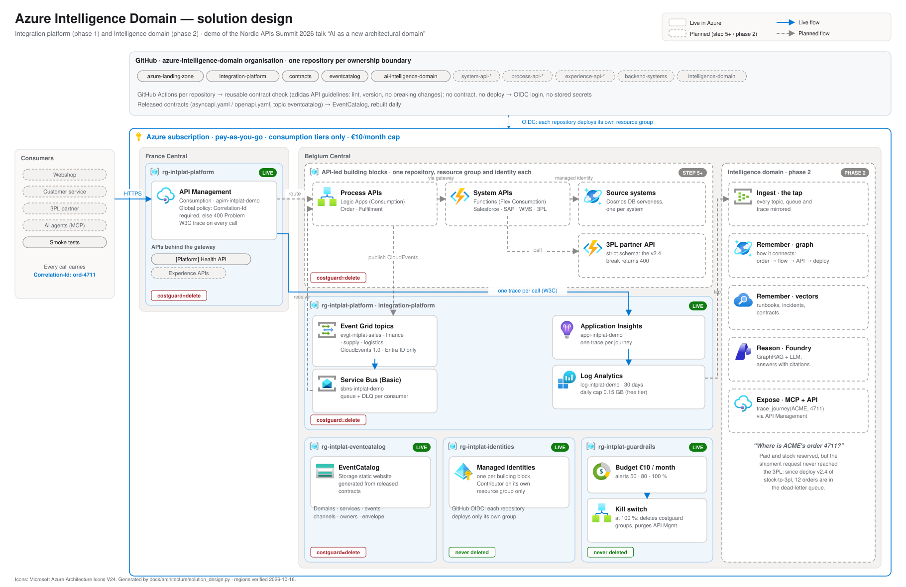
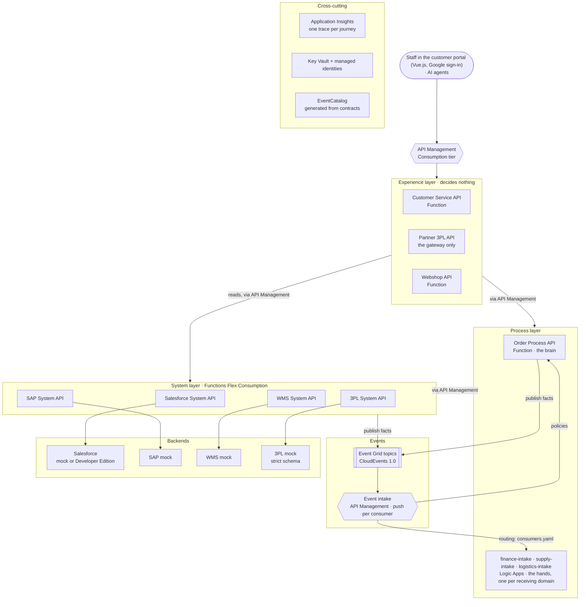
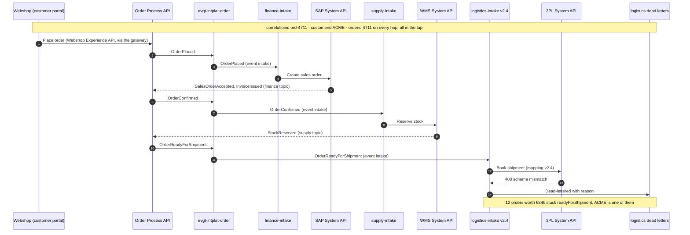

# AI Intelligence Domain — demo

A demo of the talk **"AI as a new architectural domain"**
(Nordic APIs Summit 2026, Axel Vuylsteke — The Value Hub), built on Azure.

> Every system knows its part. None knows the story.
> Your integration platform already sees every hand-off.

The demo replays one business journey, **ACME's order 4711**, through an
integration platform (Salesforce → SAP → Warehouse → 3PL). Later, an
**Intelligence domain** subscribes to everything the platform sees and answers
questions no single system can answer, such as *"Where is ACME's order
4711?"*, with cited evidence.

## Scope

- **Demo / reference only.** Not production.
- **Azure**, region Belgium Central (France Central as fallback per service).
- **Consumption tiers only.** Hard ceiling of **€10/month**, enforced by a
  budget and a kill switch ([ADR 0003](docs/adr/0003-azure-consumption-with-cost-cap.md)).
- **API-led and composable** ([ADR 0004](docs/adr/0004-api-led-composable.md)).
- **Contracts on everything**, documented in EventCatalog
  ([ADR 0005](docs/adr/0005-contracts-everywhere-eventcatalog.md)), following
  the **adidas API guidelines** ([ADR 0008](docs/adr/0008-adidas-api-guidelines.md)).
- **Tap by default**: every event, gateway mutation, agent action, deployment and trace can
  reach the Intelligence domain; nobody can opt out ([ADR 0011](docs/adr/0011-tap-by-default.md)).
- **A separate gateway for AI agents**, with an Entra identity per agent and every call
  audited ([ADR 0012](docs/adr/0012-agent-gateway.md)).
- **One repository per ownership boundary** in the GitHub organisation
  [azure-intelligence-domain](https://github.com/azure-intelligence-domain)
  ([ADR 0006](docs/adr/0006-repository-per-ownership-boundary.md)).

## Phase 1 — Integration platform

*No solid platform? No intelligence!*

| Step | What | Status |
|---|---|---|
| 0 | Repo structure, rules, decision log | ✅ |
| 1 | Foundation: Azure subscription, budget + kill switch ([guardrails](https://github.com/azure-intelligence-domain/azure-landing-zone/tree/main/guardrails)), GitHub organisation, OIDC deploy identity ([bootstrap](https://github.com/azure-intelligence-domain/azure-landing-zone/tree/main/bootstrap)) | ✅ |
| 2 | Envelope contract: CloudEvents + `correlationid`, `customerid`, `orderid` ([contracts](https://github.com/azure-intelligence-domain/contracts)) | ✅ |
| 3 | Contract tooling: linting, breaking-change checks, [EventCatalog](https://azure-intelligence-domain.github.io/eventcatalog/) | ✅ |
| 4 | Platform core: API Management, Event Grid, Service Bus, App Insights ([integration-platform](https://github.com/azure-intelligence-domain/integration-platform), [ADR 0010](docs/adr/0010-platform-core.md)) | ✅ |
| 4b | Tap by default and the agent gateway ([ADR 0011](docs/adr/0011-tap-by-default.md), [ADR 0012](docs/adr/0012-agent-gateway.md)) | ✅ |
| 5a | Order domain design: business events (Event Storming), commands and queries, BPMN flows ([process-api-order](https://github.com/azure-intelligence-domain/process-api-order), [ADR 0013](docs/adr/0013-order-domain.md)) | ✅ |
| 5b | Order domain implementation: Order Process API, Salesforce System API, source system, order topic, tapped queries ([ADR 0014](docs/adr/0014-process-layer-split.md)); journey test: order 4711 end to end, 19 hops in the tap | ✅ |
| 6 | SAP, WMS and 3PL System APIs; one intake flow per receiving domain ([ADR 0015](docs/adr/0015-one-intake-per-domain.md)); event delivery pushed through the gateway ([ADR 0016](docs/adr/0016-event-delivery-through-the-gateway.md)); the order domain's policies. Journey test: an order from placed to completed, by events | ✅ |
| 7 | Experience APIs (webshop, customer service, partner) and the Vue.js [customer portal](https://azure-intelligence-domain.github.io/customer-portal/) with Google staff sign-in ([ADR 0017](docs/adr/0017-experience-layer-and-staff-sign-in.md)); cancellations reach every domain, shipments are booked first ([ADR 0018](docs/adr/0018-cancellation-reaches-every-domain.md)). Journey test: shop, ship, deliver, pay; cancel while waiting for the truck | ✅ |
| 8 | The v2.4 break: faulty `logistics-intake` mapping, dead letters arrive | ⏸ postponed; how we handle this flow is decided later |

## Phase 2 — Intelligence domain

Tap, ingest, understand, remember, reason, expose (MCP). Planned after phase 1;
cost decisions per service.

## Architecture (phase 1)

Data models per domain, joined by their business keys: [docs/architecture/data-models.md](docs/architecture/data-models.md).

| Layer | Building blocks | Azure service |
|---|---|---|
| Gateways | People and websites: `apim-intplat-demo`. AI agents: `apim-intplat-agents` (Entra token per agent) | API Management (Consumption), France Central |
| Tap | Every topic, gateway query and mutation, agent action, deployment and trace, kept for the Intelligence domain | Event Grid tap subscriptions + Log Analytics export → `sttapintplatdemo` (`rg-intplat-tap`, never deleted) |
| Experience | Webshop, Customer Service (Functions), Partner (3PL; the gateway only), for staff signed in with Google ([ADR 0017](docs/adr/0017-experience-layer-and-staff-sign-in.md)) | API Management + Functions (Flex Consumption, Python) |
| Front end | [Customer portal](https://azure-intelligence-domain.github.io/customer-portal/), Vue.js | Storage static website (`stportalintplatdemo`) + GitHub Pages |
| Process | Domain process APIs (the brain): Order. Integration flows (the hands): one `<domain>-intake` per receiving domain ([ADR 0014](docs/adr/0014-process-layer-split.md), [0015](docs/adr/0015-one-intake-per-domain.md)) | Functions (Flex Consumption, Python); Logic Apps (Consumption) |
| System | Salesforce, SAP, WMS, 3PL | Functions (Flex Consumption, Python) |
| Events | Business events between domains | Event Grid, pushed through the gateway's event intake to each consumer; dead letters into the tap ([ADR 0016](docs/adr/0016-event-delivery-through-the-gateway.md)) |
| Backends | Simulated Salesforce, SAP, WMS and 3PL, each with its own database (ADR 0007) | Cosmos DB serverless, one account per system + Functions (3PL partner API) |
| Observability | One trace per journey | Application Insights + Log Analytics |
| Secrets & identity | No secrets in code | Managed identities; Key Vault with the first real secret ([ADR 0010](docs/adr/0010-platform-core.md)) |
| Catalog | Domains, services, events, contracts, owners | EventCatalog, generated from released contracts, on a storage static website ([ADR 0009](docs/adr/0009-eventcatalog-generated-from-contracts.md)) |

**Regions** (verified 2026-10-16): everything in **Belgium Central**, except
API Management (Consumption tier not offered there), which runs in **France
Central**. West Europe does not accept new customers for this subscription.
Since 2026-10-17 Belgium Central refuses new App Service plans for this
subscription (`429 App Service Plan Create operation is throttled`), so the two
Experience API Functions run in **France Central**, next to the gateways.

### API-led layers

Every call between layers goes through API Management. Hand-offs between
domains are events.

### The ACME 4711 journey

What the platform sees for one order. After deployment v2.4 of
`logistics-intake` (step 8), the 3PL rejects the booking and it lands in the
logistics dead letters. Until then the order goes on: the 3PL books it, the
partner reports the pick-up and the delivery, the customer pays (step 7).

## Repositories

| Repository | Owner | Status |
|---|---|---|
| [ai-intelligence-domain](https://github.com/azure-intelligence-domain/ai-intelligence-domain) | Architecture | ✅ this repository |
| [azure-landing-zone](https://github.com/azure-intelligence-domain/azure-landing-zone) | Platform team | ✅ guardrails + OIDC pipeline |
| [integration-platform](https://github.com/azure-intelligence-domain/integration-platform) | Platform team | ✅ v1.4.0: two gateways, staff sign-in, CORS, events, event intake, routing, tracing, tap |
| [contracts](https://github.com/azure-intelligence-domain/contracts) | Platform team | ✅ v1.2.0: envelope 1.1.0, rules, contract check |
| [eventcatalog](https://github.com/azure-intelligence-domain/eventcatalog) | Platform team | ✅ [GitHub Pages](https://azure-intelligence-domain.github.io/eventcatalog/) · [Azure](https://stcatalogxyxd4f2znqkqy.z50.web.core.windows.net) |
| [backend-systems](https://github.com/azure-intelligence-domain/backend-systems) | Outside world | ✅ simulated Salesforce, SAP, WMS, 3PL partner (Cosmos DB) |
| [system-api-salesforce](https://github.com/azure-intelligence-domain/system-api-salesforce) | Sales team | ✅ v1.1.0 |
| [system-api-sap](https://github.com/azure-intelligence-domain/system-api-sap), [-wms](https://github.com/azure-intelligence-domain/system-api-wms), [-3pl](https://github.com/azure-intelligence-domain/system-api-3pl) | Finance, supply, logistics teams | ✅ v1.2.0, v1.1.0, v1.1.0 |
| [finance-intake](https://github.com/azure-intelligence-domain/finance-intake), [supply-intake](https://github.com/azure-intelligence-domain/supply-intake), [logistics-intake](https://github.com/azure-intelligence-domain/logistics-intake) | Finance, supply, logistics teams | ✅ v1.1.0 (Logic Apps) |
| [process-api-order](https://github.com/azure-intelligence-domain/process-api-order) | Order team | ✅ v1.2.0: commands, queries, state machine, policies, business events, references, timeline |
| [experience-api-webshop](https://github.com/azure-intelligence-domain/experience-api-webshop), [-customer-service](https://github.com/azure-intelligence-domain/experience-api-customer-service), [-partner](https://github.com/azure-intelligence-domain/experience-api-partner) | Channel team | ✅ v1.0.0 |
| [customer-portal](https://github.com/azure-intelligence-domain/customer-portal) | Channel team | ✅ Vue.js, [GitHub Pages](https://azure-intelligence-domain.github.io/customer-portal/) · [Azure](https://stportalintplatdemo.z50.web.core.windows.net) |
| intelligence-domain | Intelligence team | ⏳ phase 2 |

How they relate: see [ADR 0006](docs/adr/0006-repository-per-ownership-boundary.md).
