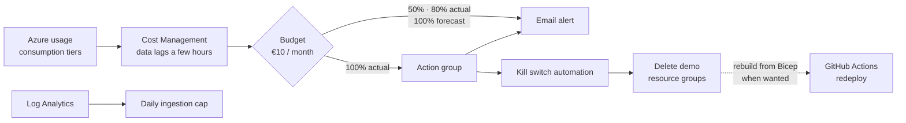

# 0003 — Azure, consumption tiers only, €10/month cap

- **Status:** accepted
- **Date:** 2026-10-16
- **Supersedes:** 0001

## Context

The demo should run on the real Azure services from the talk, not local
substitutes. Volume is tiny (under 5,000 inputs per month), so the target cost
is about €0, with a hard ceiling of **€10 per month**.

Azure pay-as-you-go subscriptions have **no built-in spending limit**. Budgets
only send alerts; they do not stop resources.

## Decision

- Host everything in Azure, region **Belgium Central**. Where a required
  service or tier is not available there, fall back to **France Central**,
  and record that per service in the README mapping table. (Originally West
  Europe; changed on 2026-10-16 because West Europe does not accept new
  customers for this subscription, for API Management and Static Web Apps
  alike.)
- Use only **consumption / pay-per-use tiers**: API Management Consumption,
  Functions (Flex) Consumption, Logic Apps Consumption, Event Grid basic
  topics, Service Bus Basic, Log Analytics pay-as-you-go with a daily cap.
- Any service with a fixed monthly fee needs its own ADR before it is used.
- Enforce the €10 ceiling with three layers:
  1. **Budget** of €10/month with alerts at 50%, 80% and 100% actual, and at
     100% forecast.
  2. **Kill switch**: at 100% actual, an action group triggers automation that
     deletes the demo resource groups. All infrastructure is code, so a
     rebuild takes minutes.
  3. **Daily caps** on Log Analytics ingestion, the usual hidden cost.

## Alternatives considered

- **Local Docker (ADR 0001).** Free and fast, but not the real Azure story.
- **Non-consumption tiers** (APIM Developer/Basic v2, Logic Apps Standard,
  Service Bus Standard). Each one alone costs €10 or more per month.

## Consequences

- Cost data in Azure lags by several hours, so the kill switch can fire after
  slightly more than €10 is spent. With consumption tiers and low volume, the
  overshoot is negligible.
- Consumption tiers have feature limits (for example, no Service Bus topics in
  Basic). The design works around them: Event Grid does fan-out, Service Bus
  Basic queues give each subscriber its own dead-letter queue.
- Phase 2 (Intelligence domain) will need fresh cost decisions: Event Hubs,
  Fabric and some APIM MCP features have fixed fees or need higher tiers.
