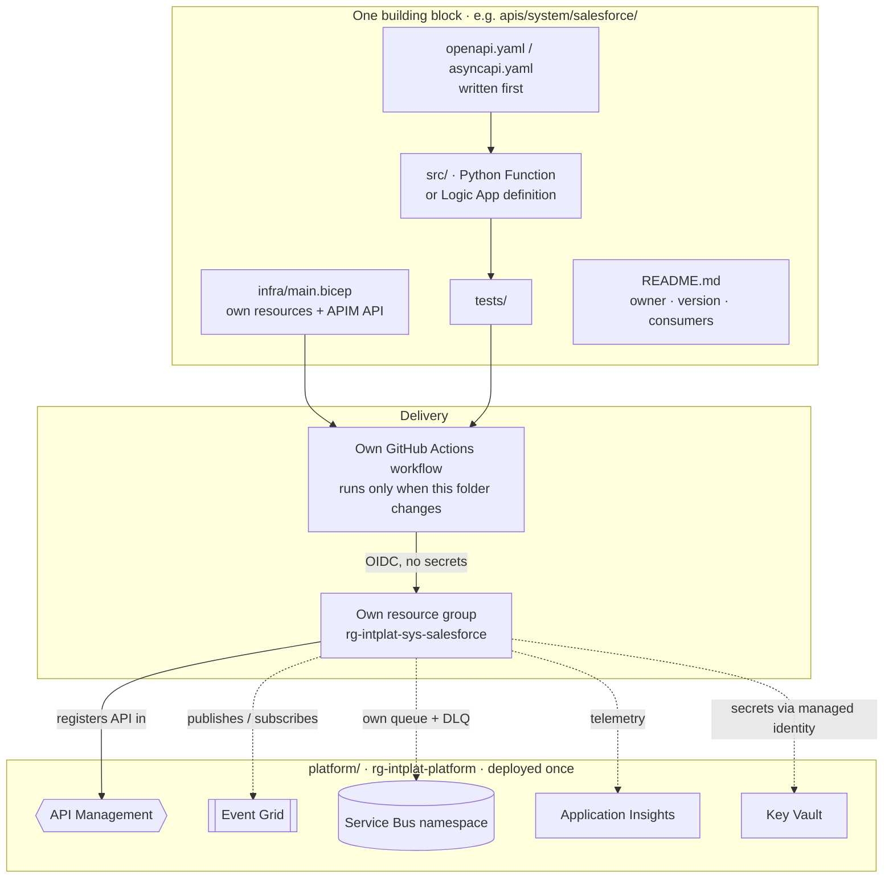

# 0004 — API-led and composable integration platform

- **Status:** accepted
- **Date:** 2026-10-16

## Context

The integration platform is the base the Intelligence domain will stand on.
It must be easy to extend, replace and explain, and every piece must be
independently deployable.

## Decision

**Three API-led layers, plus events for hand-offs between domains:**

| Layer | Purpose | Example | Azure |
|---|---|---|---|
| Experience | Shaped for one consumer channel | Customer Service, Partner, Webshop | API Management (+ thin Function if needed) |
| Process | Business logic and orchestration | Order, Fulfilment | Logic Apps Consumption |
| System | One per backend; hides its specifics | Salesforce, SAP, WMS, 3PL | Functions (Python) |
| Events | Asynchronous hand-offs between domains | OrderCreated, StockReserved | Event Grid (CloudEvents) → Service Bus queue per subscriber |

All APIs are exposed through **one API Management** instance.

**Composable means each building block:**

- lives in its own folder (`apis/<layer>/<name>/`) with its contract, code,
  infrastructure (Bicep), tests and README (owner, version, consumers);
- has its own resource group and its own pipeline, which runs only when its
  folder changes;
- can be deployed, replaced or deleted without touching any other block;
- talks to other blocks only through their published contracts, via API
  Management or events. No direct calls between implementations.

The shared foundation (API Management, Event Grid, Service Bus namespace,
Application Insights, Key Vault) lives in `platform/` and is deployed once.

## Alternatives considered

- **Pure event-driven, no API layers.** Loses the reuse and governance story
  of API-led connectivity.
- **One deployable for everything.** Simpler to start, but not composable and
  not representative of a real integration platform.

## Consequences

- More resource groups and pipelines, but each one is small and
  understandable.
- Infrastructure as code: **Bicep** with Azure Verified Modules.
- CI/CD: **GitHub Actions** with OIDC (federated credentials), no stored
  secrets.
