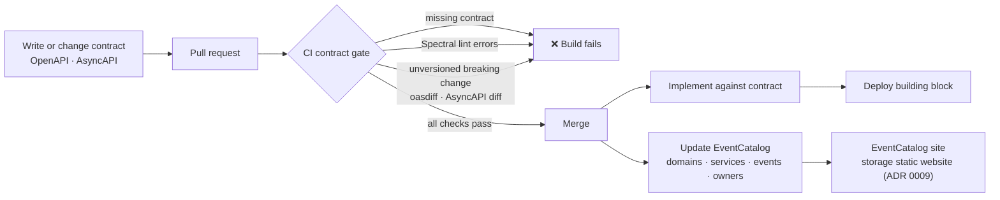

# 0005 — Contracts on everything, documented in EventCatalog

- **Status:** accepted (hosting and generation detailed in 0009)
- **Date:** 2026-10-16

## Context

The talk's base layer requires every API and event to be specified, versioned
and owned. The Intelligence domain will later need this catalog to know what
exists, who owns it and who consumes it.

## Decision

- **Every interface has a contract, internal ones included:**
  - **OpenAPI** for every HTTP interface: Experience, Process and System APIs,
    Function HTTP triggers, Logic App HTTP triggers and the mock backends.
  - **AsyncAPI** for every asynchronous interface: Event Grid topics, Service
    Bus queues and their dead-letter queues.
- **Contract first.** The contract is written and reviewed before the code.
- **No contract, no deploy.** CI fails when an interface has no contract, when
  a contract fails linting (Spectral), or when it has an unversioned breaking
  change (oasdiff for OpenAPI, AsyncAPI CLI diff for AsyncAPI).
- **EventCatalog** is the catalog: domains, services, events, commands,
  channels, owners and the contracts attached to each service. It is a static
  site, hosted for free on **Azure Static Web Apps (Free tier)**. *(Changed in
  ADR 0009: a storage static website in Belgium Central.)*

## Alternatives considered

- **Azure API Center (free plan)** as the only catalog. Covers APIs well, but
  is weaker for events, domains and ownership. It can be added later next to
  EventCatalog.
- **Contracts only on externally exposed APIs.** Leaves the internal hand-offs
  undocumented, which is exactly what the Intelligence domain needs to see.

## Consequences

- EventCatalog itself is open source. Its **AsyncAPI and OpenAPI generators**
  are dual-licensed: free for open-source projects, paid for commercial or
  proprietary use. Options:
  1. Make this repository **public and open source**: the generators are free
     and the demo doubles as a public companion to the talk.
  2. Keep it **private**: attach the spec files to EventCatalog services
     directly and keep the catalog pages in sync with a small script of our
     own.
  3. Buy a commercial licence.

**Chosen (2026-10-16): option 1.** The repository is public and open source
(MIT licence), so the EventCatalog AsyncAPI and OpenAPI generators are used
under their open-source licence.
