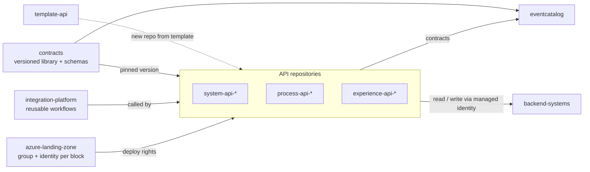

# 0006 — One repository per ownership boundary

- **Status:** accepted
- **Date:** 2026-10-16
- **Refines:** 0004 (folders per building block become repositories)

## Context

ADR 0004 makes every building block independently deployable. A single
repository would still couple them: shared history, shared permissions, and
pipelines that can reach every resource. The talk's team model (domain teams,
integration platform team, Intelligence domain team) asks for clear ownership
boundaries.

## Decision

All repositories live in the GitHub organisation
**azure-intelligence-domain**, public and MIT-licensed. One repository per
ownership boundary:

| Repository | Owner | Contents |
|---|---|---|
| `ai-intelligence-domain` | Architecture | Story, architecture, ADRs, repository map |
| `azure-landing-zone` | Platform team | Guardrails; per building block a resource group and deploy identity |
| `integration-platform` | Platform team | Shared foundation (APIM, Event Grid, Service Bus, App Insights, Key Vault) and reusable workflows |
| `contracts` | Platform team | Envelope schema, shared events, lint rules, Python envelope library |
| `eventcatalog` | Platform team | The catalog site, built from every repository's contracts |
| `template-api` | Platform team | Template repository for new APIs |
| `system-api-*`, `process-api-*`, `experience-api-*` | Domain and channel teams | One repository per API building block |
| `backend-systems` | "The outside world" | The simulated source systems and their data (see ADR 0007) |
| `intelligence-domain` | Intelligence team | Phase 2 |

Repositories are created when a step needs them, not up front.

## Alternatives considered

- **One repository with a folder per building block.** Simpler cross-cutting
  changes, but every pipeline can reach every resource, and ownership is
  only a convention.
- **A repository per layer.** Fewer repositories, but building blocks in the
  same layer would still be coupled.

## Consequences

- **Pipelines stay small:** API repositories call reusable workflows from
  `integration-platform`.
- **Same starting point:** new APIs are created from `template-api`.
- **Explicit upgrades:** API repositories pin a released version of the
  `contracts` library.
- **Least privilege:** each API repository has its own deploy identity
  (GitHub OIDC), with rights only on its own resource group.
- A change spanning several building blocks needs several pull requests. That
  is intended: they talk only through versioned contracts.
- Locally, the repositories are cloned side by side in one workspace folder.
