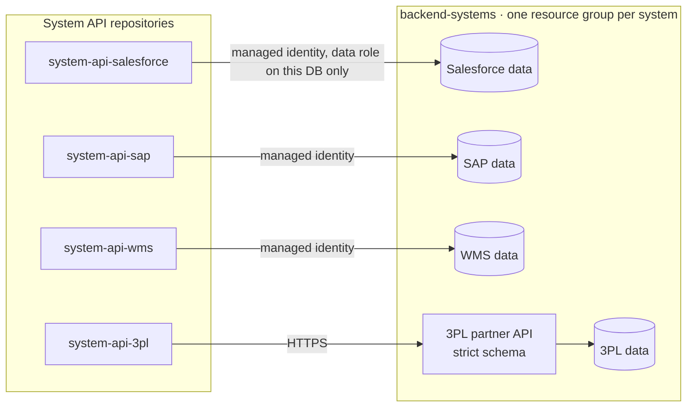

# 0007 — Each source system keeps its own state in a database

- **Status:** proposed
- **Date:** 2026-10-16

## Context

The simulated source systems (Salesforce, SAP, WMS, 3PL) must keep real
state: opportunities, sales orders, stock reservations, shipments. Flows can
then be replayed, data fetched and updated later, and the Intelligence domain
can compare what each system believes with what the platform saw.

Constraints: about €0 per month (ADR 0003), Belgium Central, and composable:
one system's data must not be reachable through another system's API.

## Decision

- **One database per source system**, owned by that system, not by its System
  API. The databases live in the `backend-systems` repository, each in its own
  resource group (`rg-intplat-backend-<system>`, tagged `costguard=delete`).
- **The System API is the only way in.** Each System API reads and writes its
  system's database through its managed identity, with a data-plane role on
  that one database. No connection strings or keys.
- Each database keeps the system's **own data model**, not a shared one.
  Translating between models is the job of the APIs and flows.
- The 3PL is an external partner, so it is simulated as a **partner API** (a
  Function enforcing its strict schema) in front of its own database.

**Database technology: to decide.**

| Option | Cost at demo volume | Strengths | Weaknesses |
|---|---|---|---|
| **Cosmos DB serverless** (recommended) | Cents per month (pay per request, no free grant) | Always instant, JSON documents fit each system's own model, simple Python SDK, Entra data-plane roles. The same service family as the phase 2 graph. | Not relational, no joins. |
| **Azure SQL Database free offer** | €0 (up to 10 free serverless databases per subscription; pauses when the monthly free allowance is used up) | Relational, which feels like a real ERP. Truly free. | Pauses after inactivity: the first call after a pause waits up to about a minute (risky in a live demo). Schema migrations and an ODBC driver needed. |

## Alternatives considered

- **Database inside each System API repository.** Fewer repositories, but it
  blurs the line between a system and the API that abstracts it: redeploying
  an API could then touch the system's data.
- **One shared database for all systems.** Cheapest to manage, but it creates
  exactly the hidden coupling the platform is meant to avoid.

## Consequences

- Replaying a scenario means resetting or seeding the databases; the
  `backend-systems` repository includes seed data for the ACME 4711 story.
- If a real system is connected later (for example a Salesforce Developer
  Edition org), only its System API changes.
