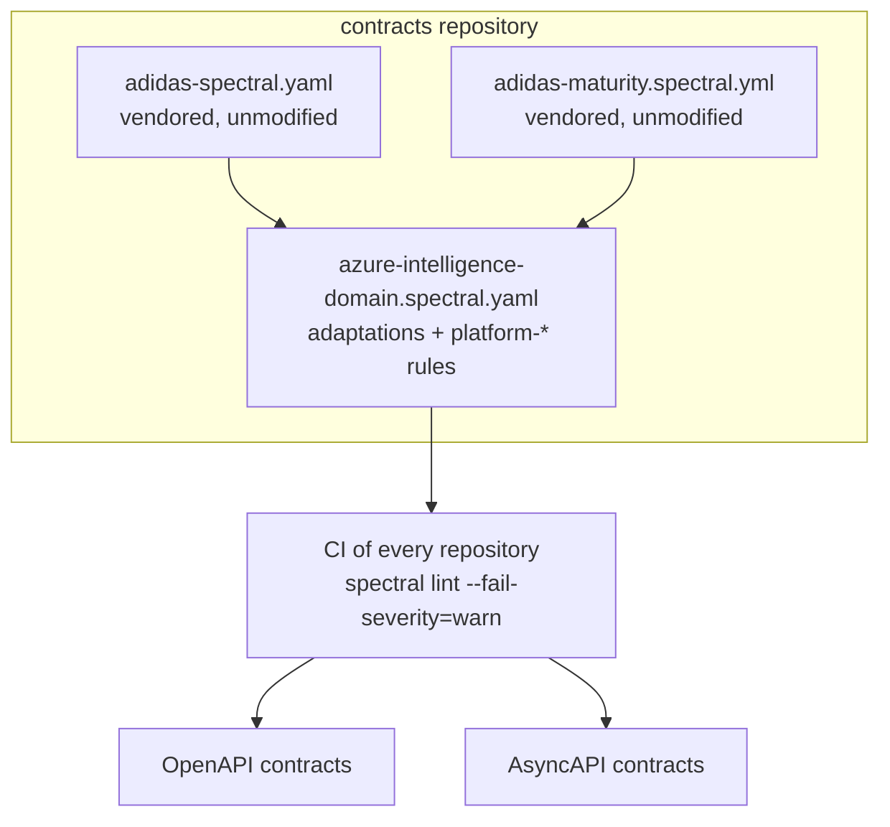

# 0008 — All contracts follow the adidas API guidelines

- **Status:** accepted
- **Date:** 2026-10-16

## Context

Every interface on the platform has a contract (ADR 0005). Those contracts
need one style guide, enforced automatically, so that every API and event
looks and behaves the same. The
[adidas API guidelines](https://github.com/adidas/api-guidelines) cover
general, REST and asynchronous APIs and come with Spectral lint rules.

## Decision

**All contracts follow the adidas API guidelines**, pinned to upstream commit
`222b294` (2025-09-19). This covers OpenAPI and AsyncAPI, internal interfaces
included.

- Both adidas Spectral rulesets are vendored **unmodified** in the `contracts`
  repository and verified by checksum. Neither upstream file contains every
  rule (`adidas-spectral.yaml` lacks the 15 maturity matrix rules;
  `.spectral.yml` lacks `adidas-headers-no-x-headers` and
  `adidas-request-GET-no-body`), so the platform ruleset extends both.
- adidas guidelines that adidas never turned into lint rules (most of the
  asynchronous guidelines, and the REST naming rules for API names, resource
  names, Title Case summaries, identifier stability and Problem Details) are
  implemented as `platform-*` rules. Each rule has a test proving it fires.
- Severity follows the wording: MUST is an error, SHOULD a warning. CI fails on
  both.

### Key adidas rules that shape the platform

| Guideline | Effect here |
|---|---|
| API first; design is the contract | Contract before code; no contract, no deploy (ADR 0005) |
| Contract lives with its implementation; one AsyncAPI spec per namespace | Event contracts live in the **producer's** repository, not in `contracts` |
| Rules for extending; immutability of published versions | Only additive, optional changes. Released versions are frozen by checksum |
| camelCase JSON fields, no nulls, plural arrays | Payloads (`data`) use camelCase; null fields are omitted |
| ISO 8601 in UTC, ISO 4217, ISO 3166 | The envelope `time` must end in `Z` |
| No version in URIs | API Management exposes APIs without `/v1`; breaking changes create a new resource variant or media type |
| HAL for success, Problem Details for errors | `application/hal+json`, `application/problem+json` |
| Hyphenated-Pascal-Case headers, no `X-` headers | The correlation header is `Correlation-Id` |
| API name `[Domain] Name API`, resource `x-summary`, Title Case summaries | Enforced by `platform-oas-*` rules |
| AsyncAPI 2.6.0, `urn:` id, contact, descriptions, servers, channel and operation fields, `x-producers` / `x-consumers` | Enforced by `platform-*` rules |
| Channel naming `namespace.source.event.topic-name` | e.g. `supply.wms.event.stock-reserved` |
| Servers defined once in a shared landscape | `asyncapi/landscape.asyncapi.yaml` in `contracts` |

## Adaptations

The adidas guidelines assume adidas tooling (Kafka, SwaggerHub, LeanIX,
Confluent Schema Registry). Where that tooling does not exist here, or where a
standard requires otherwise, the platform adapts as follows.

| adidas | Here | Reason |
|---|---|---|
| camelCase for all names | CloudEvents envelope attributes are lowercase (`correlationid`, `customerid`) | The CloudEvents specification requires attribute names of lowercase letters and digits. The `data` payload stays camelCase. |
| Kafka topics and clusters | Event Grid topics and Service Bus queues in the landscape; Azure resource names in `x-configurations` | The platform runs on Azure messaging (ADR 0003, 0004). |
| Schema Registry, FULL_TRANSITIVE | Contracts in Git; released versions frozen by checksum; breaking changes become a new event type | No schema registry in the consumption tiers; the rules for extending give the same guarantee. |
| SwaggerHub as API registry | The contract repositories plus EventCatalog | ADR 0005. |
| `x-leanixid` (SHOULD) and LeanIX in `externalDocs` | Rules off; `externalDocs` must point to the EventCatalog entry (`platform-external-docs-catalog`) | No LeanIX; EventCatalog is the catalog. |
| Contact needs email **or** url | Spectral's `contact-properties` rules (which demand both) are off; `platform-contact-email-or-url` enforces the adidas rule | Public repositories, no team mailboxes. |
| `x-producers` / `x-consumers` SHOULD | MUST | The Intelligence domain needs them to answer "who produces this" and "which consumers break if this changes". |
| One spec per namespace with `publish` (producers) and `subscribe` (consumers) on each channel | The producer's contract has only `publish` and owns the message; each consumer has its own contract with only `subscribe`, referring to the producer's released message | The AsyncAPI parser rejects one message under both operations, and EventCatalog maps `publish` to "sends" and `subscribe` to "receives". It also follows adidas's own principle that producers do not need to know their consumers. |
| Schema Registry compatibility checks | The reusable contract check: `info.version` must increase on every change; no breaking change against the last release (oasdiff for OpenAPI; `@asyncapi/diff` plus a payload check for AsyncAPI) | `@asyncapi/diff` does not classify message payload changes, and treats a raised `info.version` as breaking. The payload check implements the adidas rules for extending directly. |
| `x-gateway` values kong, nginx, aws, akamai, sap, other | `other` | Azure API Management is not in the adidas list. |
| — | Every operation MUST accept `Correlation-Id`; every event MUST use the platform envelope | The talk's "one rule", applied to synchronous and asynchronous calls alike. |

## Alternatives considered

- **Zalando RESTful API guidelines.** Comprehensive for REST, but without
  asynchronous guidelines or an equivalent AsyncAPI rule set.
- **Spectral defaults only.** Validates syntax, not design.
- **Editing the adidas rulesets in place.** Faster to tweak, but it hides
  every deviation. Vendoring unmodified and adapting on top keeps each
  deviation explicit, reasoned and reviewable.

## Consequences

- Every repository calls the reusable workflow
  `contracts/.github/workflows/contract-check.yml` before it deploys: no
  contract, no deploy.
- A known Spectral 6.17 bug rejects server variable `examples` arrays
  (AsyncAPI 2.6 defines an array); the landscape describes examples in the
  description instead.
- Updating the guidelines means re-vendoring from a newer upstream commit and
  rerunning the tests.
