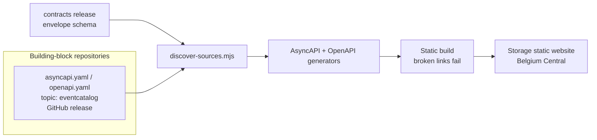

# 0009 — EventCatalog, generated from released contracts

- **Status:** accepted
- **Date:** 2026-10-16
- **Implements:** 0005 (catalog), 0006 (composable repositories)

## Context

Every domain, service, API, event and owner must be in the catalog from the
step that builds it (ADR 0005, ground rule 6). With one repository per
building block (ADR 0006), the catalog must not become a central bottleneck
where every new service needs a change.

## Decision

**The catalog is generated from the released contracts in each repository.**
Only domains, teams and platform documentation are written by hand in the
[eventcatalog](https://github.com/azure-intelligence-domain/eventcatalog)
repository.

- **Discovery, no registration.** A repository is cataloged when it has the
  GitHub topic `eventcatalog`, a release, and `asyncapi.yaml` and/or
  `openapi.yaml` in its root. Only the latest **release** is used, never work
  in progress.
- **Everything is read from the contract**, using conventions the contract
  check already enforces: the domain from the AsyncAPI `id`
  (`urn:azure-intelligence-domain:<domain>:<name>`) or the OpenAPI title
  (`[Domain] Name API`); the owner is `<domain>-team`.
- **Producers own messages, consumers refer to them.** A producer's contract
  has only `publish` operations and defines the message; a consumer's contract
  has only `subscribe` operations and refers to the producer's released
  message. The EventCatalog generator maps exactly this: `publish` = owns and
  sends, `subscribe` = references and receives.
- **Generator runs**: one per contract type and domain, configured from
  `sources.json`.
- **Rebuilt** on every change to the catalog, daily, and on demand.
- **Hosting**: an Azure Storage static website in Belgium Central (about
  €0), deployed by the catalog's own identity (building block `eventcatalog`
  in the landing zone). The storage key is fetched at deploy time and never
  stored.
- **Tested end to end**: released contract templates must produce the
  producer, consumer and API pages in the right domains.

## Licence

`@eventcatalog/core` 5.x is licensed under the Business Source License 1.1;
the generators are MIT. This catalog qualifies for Free Use on two grounds:
it documents a Public Open Source Project (MIT-licensed repositories that
document only this project's software), and it is published without charge,
which the licence explicitly excludes from "Hosted Offering". Without a
`license.jwt`, EventCatalog shows a 60-day trial notice and then a reminder;
builds keep working. A free `license.jwt` can be obtained by confirming
eligibility at eventcatalog.cloud.

Using EventCatalog for client work is a separate question (section 3 of the
licence) and is not covered by this decision.

## Alternatives considered

- **Hand-written catalog pages.** Drift from the contracts within weeks.
- **EventCatalog Federation** (each repository its own catalog, combined
  centrally). More autonomy for documentation beyond the contract, but every
  repository would duplicate its contract as catalog markdown, and the
  feature is an MVP. Can be added later for repositories that need it.
- **Azure Static Web Apps (Free).** The obvious host, but within Europe it is
  only offered in West Europe, which does not accept new customers for this
  subscription. East US 2 would work, but would move the catalog outside the
  EU.

## Consequences

- Adding a service never touches the catalog repository.
- A contract that the generator cannot parse breaks the catalog build, which
  is caught in the producer's own contract check first (same parser rules).
- The AsyncAPI parser requires a `messageId` on every message and rejects a
  message referenced from both `publish` and `subscribe` in one document;
  both are now lint rules (`platform-message-id`,
  `platform-operation-one-direction`).
