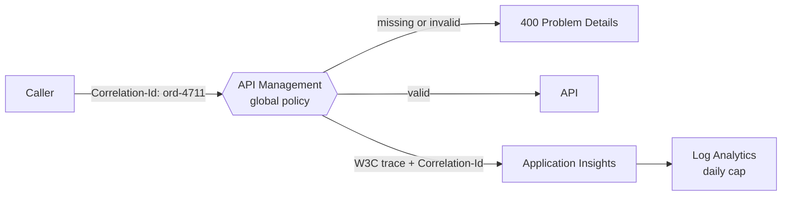

# 0010 — Platform core: gateway, events, queues, tracing

- **Status:** accepted
- **Date:** 2026-10-16

## Context

Every building block needs the same foundation: one gateway for APIs, topics
for business events, queues for consumers, and one place for telemetry. It
must cost about €0 (ADR 0003), use no keys (managed identities only), and
enforce the one rule from the talk for synchronous calls too.

## Decision

The [integration-platform](https://github.com/azure-intelligence-domain/integration-platform)
repository deploys the foundation into `rg-intplat-platform`, through its own
building-block identity.

| Resource | Name | Region | Choices |
|---|---|---|---|
| API Management | `apim-intplat-demo` | France Central | Consumption tier (not offered in Belgium Central). Service-wide W3C tracing to Application Insights, `Correlation-Id` header logged, client IPs not logged. |
| Event Grid topics | `evgt-intplat-<domain>` | Belgium Central | One per business domain (sales, finance, supply, logistics). CloudEvents 1.0 input schema. Local auth disabled. |
| Service Bus | `sbns-intplat-demo` | Belgium Central | Basic tier. One queue per consumer, added with that consumer. Local auth disabled. |
| Application Insights | `appi-intplat-demo` | Belgium Central | Workspace-based. |
| Log Analytics | `log-intplat-demo` | Belgium Central | 30-day retention; **daily cap 0.15 GB**, within the free 5 GB per month. |

**The gateway enforces the one rule.** A global API Management policy applies
to every API, now and in the future: a call without a valid `Correlation-Id`
(same format as the envelope's `correlationid`) gets `400` Problem Details;
every response echoes the `Correlation-Id`.

**Names are fixed**, not randomised, and match the shared landscape in the
`contracts` repository, so other building blocks derive them instead of
looking them up. Renaming one is a breaking change.

**The platform dogfoods its own rules.** A `[Platform] Health API`, answered
by the gateway itself, has an adidas-checked contract, passes the reusable
contract check, is released and cataloged like any other API, and is used by
the pipeline's smoke test.

**Smoke test after every deployment:** `200` HAL with the `Correlation-Id`
echoed; `400` without or with an invalid one; and the call is found in
Application Insights (ingestion takes a few minutes).

**Rebuild after a kill.** API Management stays soft-deleted for 48 hours
after its resource group is deleted, which would block a rebuild under the
same name. The kill switch therefore purges soft-deleted API Management
services after deleting the resource groups.

## Not now: Key Vault

There is no secret to store: every building block uses its managed identity,
and keys or tokens the pipelines need are read at deploy time and masked.
Following the adidas minimal-surface principle, Key Vault is added with the
first real secret (for example credentials of an external partner). Its own
soft delete will need the same purge treatment as API Management.

## Alternatives considered

- **API Management Developer or Basic v2 tier.** More features (for example
  built-in cache, developer portal), but a fixed monthly fee above the cap.
- **Service Bus Standard (topics).** Fan-out in Service Bus itself, but about
  €10 per month. Event Grid does the fan-out at pay-per-use cost.
- **Random name suffixes.** Avoid global name clashes, but every consumer
  would have to look names up; the fixed names were verified as available.

## Consequences

- The first consumer adds its own Service Bus queue and Event Grid
  subscription at step 5; how a consumer gets those rights across resource
  groups is decided then.
- Telemetry beyond 0.15 GB per day is dropped until the next day: enough for
  a demo, and it protects the budget.
