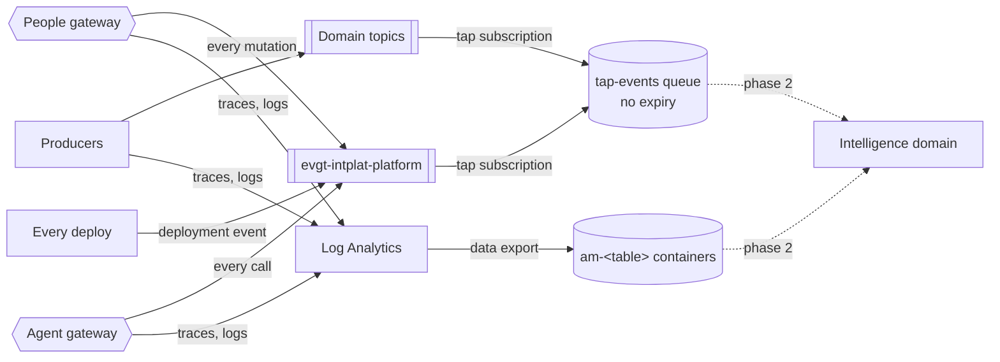

# 0011 — Tap by default: everything that enters the platform can reach the Intelligence domain

- **Status:** accepted
- **Date:** 2026-10-16

## Context

The talk's base layer requires "a tap on everything: every topic mirrored to
the Intelligence domain", and "subscribe by default, opt-out not opt-in". The
Intelligence domain (phase 2) consumes business events, API calls, runtime
telemetry and delivery and change events. It does not exist yet, but
everything that happens from the first building block on must already be
captured, or its history is lost.

Event Hubs, the talk's tap, costs about €10 per month on its own (ADR 0003).

## Decision

**The platform owns the tap.** Producers and consumers cannot forget it or
opt out: the platform creates the subscriptions and the gateways emit the
events in their global policies.

| Talk input (slide 8) | Channel | Captured by |
|---|---|---|
| Business events | Events | A `tap` subscription (all event types) on every domain topic |
| API calls | Events + telemetry | People gateway: every mutation as `com.acme.platform.gateway.mutation`. Agent gateway: every call as `com.acme.platform.agent.action`. All calls: Application Insights. |
| Runtime telemetry | Telemetry | Log Analytics data export: `AppRequests`, `AppDependencies`, `AppExceptions`, `AppTraces`, Event Grid and Service Bus logs |
| Delivery and change | Events | Every pipeline publishes `com.acme.platform.deployment.completed` (reusable action `deployment-event`) |

- **Where:** `sttapintplatdemo` in `rg-intplat-tap`, which has no `costguard`
  tag, so the history **survives the kill switch**. Queue `tap-events` (no
  expiry) for CloudEvents; containers `am-<table>` for telemetry;
  `tap-deadletter` for events Event Grid could not deliver (for example over
  the 64 KB queue limit).
- **Platform events use the envelope** (1.1.0): `componentid` identifies the
  API, agent target or deployed building block, and `correlationid` joins
  them with the business journey.
- **Mutations are tapped when they come in** ("action received", with the
  request payload up to 16 KB); their outcome is in the telemetry tap, joined
  by request id and `Correlation-Id`. This also covers calls the gateway
  answers itself and calls that fail.
- **Entra ID only**: topics deliver with their own managed identity; the
  gateways publish with theirs.
- **Proven after every platform deploy**: a probe on every topic plus a
  mutation and two agent actions must all arrive in the tap queue.
- **Routing is the platform's job.** Building blocks get only data-plane roles
  (ADR 0006 refined): the landing zone lets each block grant a fixed list of
  data-plane roles within its own resource groups, never Owner or Contributor.

## Alternatives considered

- **Event Hubs now.** The talk's design, but a fixed monthly fee breaks the
  cap. Phase 2 can switch the tap target; the platform-owned subscriptions
  stay.
- **Producers publish to the tap themselves.** Opt-in by definition; one
  forgotten producer and the history has a hole.
- **Log every request body in Application Insights.** Simpler, but bodies of
  reads add volume and cost, and telemetry is sampled and capped; mutations
  are the actions that matter.

## Consequences

- Payloads in the tap can contain personal data. Masking is the Intelligence
  domain's first job ("Understand: normalise & mask PII"), and tap access is
  limited to data-plane roles.
- Telemetry above the daily cap (0.15 GB) is not exported either.
- The tap queue grows until phase 2 drains it; storage stays in cents.
- Dead-lettered Service Bus messages appear in the telemetry (logs); their
  content is read from the queues themselves in phase 2.
