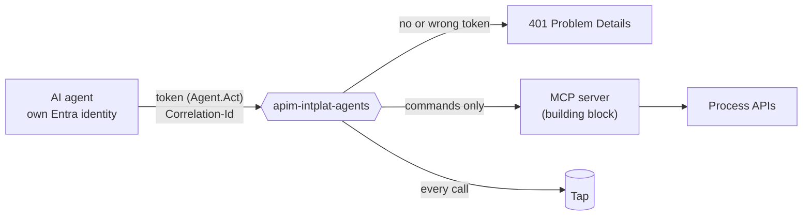

# 0012 — A separate gateway for AI agents

- **Status:** accepted
- **Date:** 2026-10-16

## Context

The existing gateway (`apim-intplat-demo`) serves people and websites. AI
agents will trigger mutations on the integration platform: the "Act" step of
the talk's ladder (Describe, Diagnose, Recommend, Act), which must be earned
"with evidence quality, policy and audit". Agents need a different trust
model: every action attributable to one agent, audited, limited, and
restricted to what agents are allowed to do.

API Management's native MCP server features are not available on the
Consumption tier; the cheapest tier with them (Developer) costs about €45 per
month.

## Decision

A **second API Management gateway, `apim-intplat-agents`** (Consumption,
France Central), only for agents:

| Concern | How |
|---|---|
| Who | Only an **Entra ID token per agent** for the `intplat-agent-gateway` application with the `Agent.Act` app role. The application requires role assignment, so only identities explicitly made agents get a token. Otherwise `401` Problem Details. |
| What | Only APIs published in the `agents` product: **commands to Process APIs**. Agents never reach System APIs or source systems. |
| Journey | The same `Correlation-Id` rule as every gateway. |
| Audit | **Every call, reads included**, is published to the tap as `com.acme.platform.agent.action`, with the agent's identity (ADR 0011). |
| Limits | 60 calls per minute per agent subscription (`rate-limit`; `rate-limit-by-key` is not available on Consumption). |
| MCP | An **MCP server of our own** (a building block, for example a Function) behind this gateway, governed by the same policies. It can move to native MCP later without changing the agents. |

Agents are made by a tenant administrator:
`azure-landing-zone/bootstrap/agent-gateway-app.sh <principal-object-id>`.

## Alternatives considered

- **One gateway for people and agents.** Fewer resources, but one policy set
  would have to fit both trust models, and an agent problem would affect the
  websites.
- **Developer tier for native MCP.** About €45 per month and no SLA: breaks
  the cap. Basic v2: more than €130 per month.
- **Subscription keys only.** Keys identify a subscription, not an agent, and
  are easily shared.

## Consequences

- Each agent needs both its Entra identity (with `Agent.Act`) and a
  subscription to the `agents` product (for the rate limit).
- High-impact commands can later require a human approval step before the
  gateway forwards them; the audit trail is already in place.
- The `[Platform] Health API` is published on both gateways; its smoke test
  proves the token check, the audit and the tap after every deploy.
