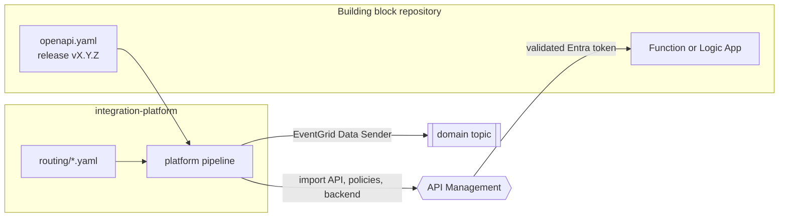

# 0014 — Process layer split, runtime identities, platform-owned routing

- **Status:** accepted
- **Date:** 2026-10-16
- **Refines:** 0004 (process layer), 0006 (building blocks), 0011 (routing)
- **Amended by:** 0015 (one integration flow per receiving domain)

## Context

ADR 0004 put the whole process layer in Logic Apps. The order domain showed two
different kinds of process work: deciding (the order's state machine,
validation, idempotency, publishing facts) and moving data between systems
(mapping an order to an ERP sales order, stock to a 3PL shipment request).
Building the first vertical slice also needs answers on how building blocks
call each other through the gateway without secrets, and who registers APIs
and routes events.

## Decision

**1. The process layer has two kinds of building blocks.**

| Kind | Technology | Example | Owns |
|---|---|---|---|
| Domain process API (the brain) | Azure Function (Python, Flex Consumption) | `process-api-order` | Status, rules, the domain's events |
| Integration flow (the hands) | Logic App (Consumption), one per receiving domain (ADR 0015) | `finance-intake`, `logistics-intake` | Mapping and calls to its own domain's systems |

Integration flows react to events from their own queue and call System APIs
through the gateway. They publish nothing of their own: the System API behind
them publishes the fact (`SalesOrderAccepted`, `StockReserved`).

**2. Every building block has a runtime identity**, separate from its deploy
identity: a user-assigned managed identity `id-intplat-<block>-runtime` in
`rg-intplat-identities`, created by the landing zone. It survives the kill
switch, and other building blocks can look it up by name.

**3. Internal calls go through the gateway, with Entra tokens.** The main
gateway publishes System APIs in a product `system-apis` that people cannot
use: a caller presents an Entra token for the `intplat-platform-apis`
application, and the gateway accepts only the client ids on the platform's
allow-list. No subscription keys, so no secrets and no Key Vault.

**4. The platform owns the gateway and the routing, as configuration** in the
`integration-platform` repository (`routing/`):

| File | Says |
|---|---|
| `apis.yaml` | Which repository's released `openapi.yaml` is published at which path, behind which product and backend |
| `producers.yaml` | Which runtime identity may publish to which topic |
| `internal-callers.yaml` | Which runtime identities may call the `system-apis` product |
| `consumers.yaml` (later) | Which consumer gets which queue, fed by which event types |

The platform pipeline imports each API from its released contract, so the
gateway always serves exactly what the contract says.

## Alternatives considered

- **Logic Apps for all process work** (ADR 0004 as written). Visual, but the
  order's state machine, idempotency and envelope validation are rules that
  belong in tested code.
- **Subscription keys for internal calls**, kept in Key Vault. Works, but adds
  the first secret and its rotation, where a managed identity needs none.
- **Each building block registers its own API in API Management.** It would
  need rights on the platform's resource group, and nobody would own the
  gateway's consistency.

## Consequences

- A new API is live after its own release **and** an entry in `apis.yaml`.
- Deploy identities and runtime identities have different rights: the deploy
  identity builds the resource group, the runtime identity calls and publishes.
- The `intplat-platform-apis` application is created once by a tenant
  administrator (bootstrap), like the agent gateway's.
