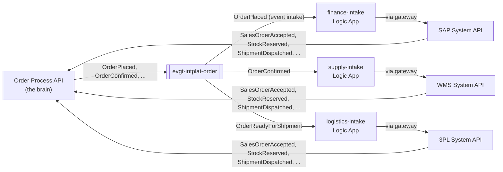

# 0015 — One integration flow per receiving domain

- **Status:** accepted
- **Date:** 2026-10-16
- **Amends:** 0014 (process layer split: the integration flows)

## Context

ADR 0014 named the integration flows after a source and a target: `order-to-erp`,
`order-to-warehouse`, `stock-to-3pl`. They react to events, so the publisher never knows them, but
the naming and the grain (one small flow per pair of systems) read as point-to-point, and each new
pair adds a flow nobody clearly owns.

Two ways to group them:

- **Per publishing domain**: one order-domain Logic App that calls every System API. That is
  orchestration: the order team would own SAP, WMS and 3PL mappings, and one 3PL change would
  redeploy the order domain's flow.
- **Per receiving domain**: each domain has one Logic App that takes in what it needs from other
  domains and speaks only to its own System APIs.

## Decision

**Every receiving domain has one integration flow, `<domain>-intake`**: one Logic App
(Consumption), owned by that domain's team. The platform routes the event types the domain
subscribes to (`consumers.yaml`) to it through the gateway's event intake (ADR 0016); the flow
switches on the event type and calls only its own domain's System APIs, through the gateway.

| Flow | Owner | Receives | Calls | The System API then publishes |
|---|---|---|---|---|
| `finance-intake` | finance-team | OrderPlaced | SAP System API | SalesOrderAccepted / SalesOrderRefused, InvoiceIssued (PaymentReceived when the bank pays) |
| `supply-intake` | supply-team | OrderConfirmed | WMS System API | StockReserved |
| `logistics-intake` | logistics-team | OrderReadyForShipment | 3PL System API | ShipmentDispatched (ShipmentDelivered on the partner's notice) |

Built in step 6 (2026-10-17) with two refinements: logistics reacts to **OrderReadyForShipment**
rather than StockReserved (the order domain decides it is ready, and its event carries the address
the 3PL needs), and amendments and cancellations are not taken in yet (they need facts such as
SalesOrderCancelled and StockReleased, to be named with the user).

A flow still publishes nothing of its own (ADR 0014): the System API behind it publishes the fact.

## Alternatives considered

- **One flow per pair of systems** (ADR 0014 as written). Small and isolated, but many flows
  without a clear owner, and the names suggest point-to-point wiring.
- **One Logic App per publishing domain, calling every System API.** Fewer resources, but it is an
  orchestrator inside the order domain: the order team owns other domains' mappings, and every
  target's change or failure lands in the order domain.

## Consequences

- The team that knows a system owns its mapping, its flow, its queue and its dead letters.
- The v2.4 break is `logistics-intake` v2.4: logistics deploys it, the 3PL rejects the new
  mapping, and the messages land in logistics' own dead-letter queue, right after the deployment
  event in the tap.
- A domain's flow grows with every event type it takes in; a switch per event type keeps it
  readable (three to five types per domain in this demo).
- Logic Apps Consumption, pushed by Event Grid through the gateway (ADR 0016): no polling, no
  Standard plan (fixed fee).
