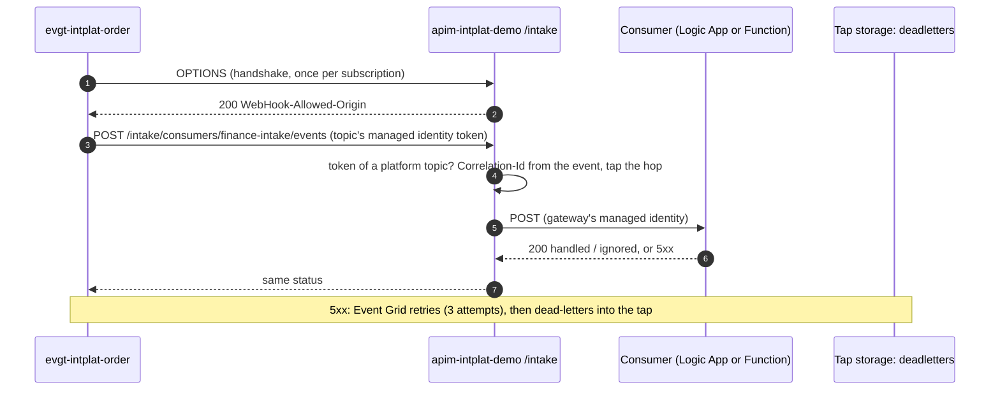

# 0016 — Event delivery: pushed by Event Grid, through the gateway

- **Status:** accepted
- **Date:** 2026-10-17
- **Amends:** 0010, 0011 (Service Bus queue per subscriber), 0014 (`consumers.yaml`)

## Context

The plan was Event Grid → one Service Bus queue per consumer (with its dead-letter queue) → the
consumer. For the intake flows (Logic Apps Consumption, ADR 0015) that fails the cost rule, and
Event Grid cannot push to a Logic App directly. Both were measured on 2026-10-17:

| Option | Finding |
|---|---|
| Logic App with a Service Bus trigger | A polling trigger: every poll is a billed connector execution, messages or not (€0.000117, Azure retail prices, Belgium Central). One poll a minute is ≈ €5 per Logic App per month: three flows exceed the €10 ceiling |
| Event Grid → Logic App HTTP trigger | Event Grid's CloudEvents webhook handshake is an `OPTIONS` request; a Logic App Request trigger accepts one method only: `TriggerRequestMethodNotValid: expected 'POST' and actual 'OPTIONS'` (probe Logic App, deleted after the test) |

## Decision

**Event Grid pushes every event to the gateway's [Platform] Event Intake API, which hands it to the
consumer's backend.**

- **Routing stays platform-owned and declarative**: `routing/consumers.yaml` says which consumer
  receives which event types from which topic. The platform creates one Event Grid subscription per
  consumer and topic, filtered on those types, delivering with the topic's managed identity and an
  Entra token for `intplat-platform-apis`.
- **Only Event Grid gets in**: the intake accepts tokens of the platform topics' identities only.
  The consumer accepts only the gateway's identity (Logic App OAuth policy, Function Easy Auth).
  No shared access signature or key leaves Azure.
- **Every delivery is a hop through the gateway**: tapped and traced like every call (ground
  rule 1, ADR 0011).
- **Dead letters land in the tap** (`sttapintplatdemo`, container `deadletters`, folder per topic
  and consumer), where the Intelligence domain reads them; nobody has to search run histories.
- **Conventions**: a Logic App consumer's trigger is named `event`; a Function consumer exposes
  `POST /intake`. A consumer answers 2xx when it handled or deliberately ignored the event, 5xx when
  it should be retried.

Service Bus stays in the platform (no fixed fee, no queues today) for a future consumer that needs
ordered or batched processing.

## Alternatives considered

- **Service Bus queue per consumer, polling Logic Apps** (the plan). Native dead-letter queues, but
  ≈ €5 per flow per month idle, and up to a polling interval of delay per hop.
- **A longer polling interval** (15 minutes: ≈ €0.35 per flow). Affordable, but a journey of three
  hops would take up to 45 minutes: no demo.
- **Logic App Standard** (built-in Service Bus trigger, no per-poll billing). A fixed monthly fee:
  against the cost rule.
- **Event Grid → Logic App with the Event Grid connector trigger.** The connector creates its own
  subscription: routing would no longer be the platform's, and dead letters would need handling in
  every flow.

## Consequences

- Idle costs nothing: a consumer is billed per event it handles. API Management Consumption counts
  every delivery as a call (the first million per month are free).
- Event Grid's delivery timeout is 30 seconds: a consumer answers synchronously within it, so its
  work per event stays small (one System API call).
- After a kill-switch rebuild, the platform routes only to consumers that already exist: rerun the
  platform pipeline once the consumers are deployed.
