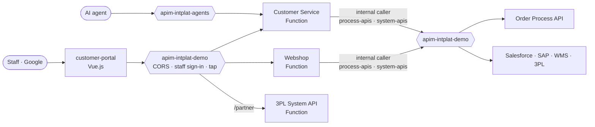

# 0017 — The experience layer, the customer portal and staff sign-in with Google

- **Status:** accepted
- **Date:** 2026-10-17
- **Refines:** 0004 (Experience layer), 0012 (agent gateway), 0014 (products, internal callers)

## Context

Step 7 completes the integration platform: people (customers via the webshop, customer service,
the 3PL partner) need to reach it, and a front end must show *everything* about an order. The user
decided (2026-10-17):

- A **Vue.js** front end; sign-in with **Google**, only **`@thevaluehub.be`** accounts.
- Everyone signed in is **staff** and sees **all customers' orders**.
- Three Experience APIs: **Webshop**, **Customer Service**, **Partner (3PL)**, plus a customer
  service screen and paying an invoice in the webshop.

## Decision

**1. People reach the Experience APIs only.** The main gateway's products:

| Product | Who | How |
|---|---|---|
| `webshop`, `customer-service`, `partners` | Staff in the customer portal | Google ID token: audience = the portal's OAuth client, `hd` = `thevaluehub.be` (validated by `validate-jwt` against Google's OpenID configuration) |
| ″ | The platform's journey test | Entra ID token for `intplat-platform-apis` of an allow-listed identity |
| `process-apis` (new), `system-apis` | Building blocks only | Entra ID token of an identity on `routing/internal-callers.yaml` |
| `agents` (agent gateway) | AI agents | Entra token per agent (ADR 0012); Customer Service is published there too |

No subscription keys for people: the staff policy picks the issuer from the token, then validates
it in full; anything else is `401 Staff Sign-In Required`. The Order Process API moves from the
key-based product `processes` to `process-apis`: people never call a Process API directly.

**2. Two Experience APIs are thin Functions; one is configuration.**

| Experience API | What | Implementation |
|---|---|---|
| Webshop | Catalogue, place an order (priced from Salesforce), follow it, cancel, change address, pay | Function: composes Order, Salesforce, SAP, 3PL |
| Customer Service | Any customer at a glance, any order with what every domain knows, hold/release/reschedule/cancel | Function: composes Order, Salesforce, SAP, WMS, 3PL |
| Partner | The 3PL partner's bookings, pick-up and delivery notices | **No code**: the gateway serves a subset of the 3PL System API's contract under `/partner` |

An Experience API **decides nothing**: it reads through the gateway (as its runtime identity, an
internal caller) and passes commands to the order domain, which answers `409` when it refuses. It
answers with HAL `_links` for what the order domain allows *now*, so the portal shows only the
buttons that work. Calling System APIs directly from an Experience API (for reads: invoices,
shipment, reservation) is allowed: there is nothing to orchestrate.

**3. The customer portal** (`customer-portal`, Vue 3 + Vite) is a static site on **GitHub Pages**
and an **Azure Storage static website** (`stportalintplatdemo`, Belgium Central), with hash routes
so one build serves both. It calls the gateway from the browser: the gateway's global policy
answers **CORS** for the origins in `routing/staff.yaml`. Every call carries a `Correlation-Id`
(`ord-<orderId>`), so a click and everything it causes is one journey in the tap. The tap records
**who** called (the staff member's e-mail, or the building block's application id).

## Alternatives considered

- **Entra ID with demo accounts**, or **Entra External ID**: free, but the user wants Google and
  the Workspace domain as the boundary.
- **One Experience API for everything**: fewer resources, but each channel has its own team and
  shape (ADR 0006); customer service is also an agent's tool.
- **A Function for the Partner API**: nothing to compose; the gateway alone is enough.
- **Static Web Apps** for the portal: not available in Belgium Central, and West Europe does not
  take new customers for this subscription (ADR 0009).

## Consequences

- The Google OAuth client (consent screen *Internal*, Web application) is created once by hand in
  the Google Cloud Console; its client id is public and lives in `routing/staff.yaml` and the
  portal's `.env`. Authorised JavaScript origins: the two portal hosts and `localhost:5173`.
- A Google ID token lasts an hour; the portal asks to sign in again.
- In production the 3PL partner would sign in with its own identity; in the demo, staff play it.
- Cost: two Functions on Flex Consumption and a storage account; idle ≈ €0.
- Region: the two Functions run in **France Central** (the fallback): Belgium Central answered every
  new App Service plan for this subscription with `429 ... throttled` (2026-10-17, probed in both
  regions). The portal's storage stays in Belgium Central.
