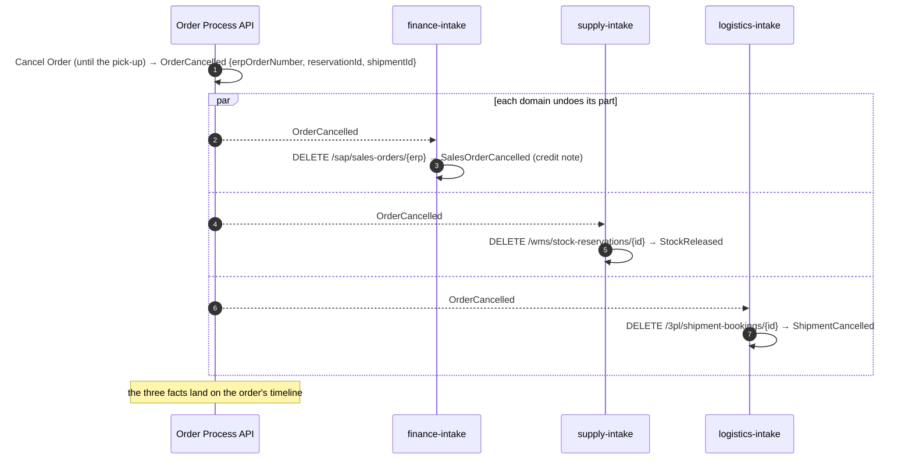

# 0018 — A cancellation reaches every domain; shipments are booked first

- **Status:** accepted
- **Date:** 2026-10-17
- **Refines:** 0013 (order domain), 0015 (one intake per domain)

## Context

Until step 6 a cancelled order stayed cancelled in Salesforce only: SAP kept its sales order and
invoice, the warehouse its reservation. And the 3PL picked a shipment up the moment it was
requested, so an order ready for shipment could never be cancelled in time. The user decided
(2026-10-17) the facts and the rules:

| Domain | Undoes | Fact |
|---|---|---|
| Finance (SAP) | Cancels the sales order; a credit note reverses the invoice | **SalesOrderCancelled** |
| Supply (WMS) | Releases the reserved stock | **StockReleased** |
| Logistics (3PL) | Cancels the booking, until the partner picks it up | **ShipmentCancelled** |
| Logistics (3PL) | Books the consignment first; the partner reports the pick-up | **ShipmentBooked** |

Order lines can be amended only while the order is `placed`; after that the customer cancels and
orders again.

## Decision

**The order knows where it lives.** The order domain records, from the other domains' facts, its
**references** (SAP sales order, invoice, credit note; WMS reservation; 3PL shipment and tracking
number) and a **timeline** of every fact about it. **OrderCancelled** names what each domain has
(`erpOrderNumber`, `reservationId`, `shipmentId`), and each domain's intake undoes its own part, if
it has one:

**Shipments are booked, then picked up.** The 3PL System API gets `shipment-bookings` (book, list,
cancel, the pick-up notice); `ShipmentDispatched` now follows the partner's pick-up notice (Partner
Experience API). An order stays `readyForShipment` while it waits for the truck, and can be
cancelled until then. The old one-step `POST /shipments` stays, deprecated: contracts never break.

**Contracts grow without breaking** (adidas): a cancelled SAP sales order gets a `cancellation`
object and a reversed invoice a `creditNote` object rather than new status values; the WMS
reservation's `status` is deprecated for an extensible `lifecycleStatus`.

## Alternatives considered

- **Each System API cancels by order id** (no references): SAP's sales order number is its own,
  and the intake would need a lookup per cancellation.
- **One cancellation flow orchestrating all three**: back to point-to-point (ADR 0015).
- **A `CreditNoteIssued` fact of its own**: one more fact for the same moment; the credit note is
  part of the cancellation.

## Consequences

- **The known race:** a cancellation that overtakes a fact in flight (cancelled within seconds,
  while SAP or the WMS is still processing) does not name what was not yet recorded. The late fact
  is recorded on the order (customer service sees it), but that system keeps its document. Fixing
  it needs either compensating facts or the systems refusing work for cancelled orders: later.
- A pick-up notice racing a cancellation ends in `409 Already Picked Up` in the 3PL, then the
  logistics dead letters: customer service handles a return.
- Orders placed before process-api-order 1.2.0 have no references; the Experience APIs find their
  shipment and reservation by the systems' own numbering.
