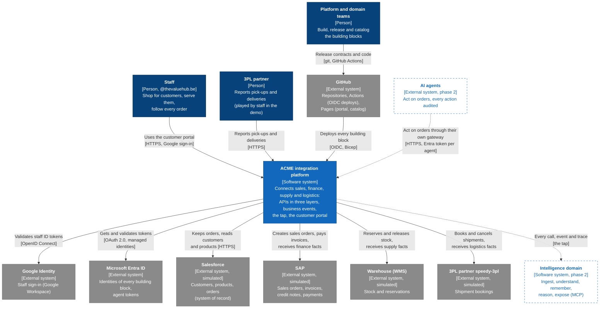
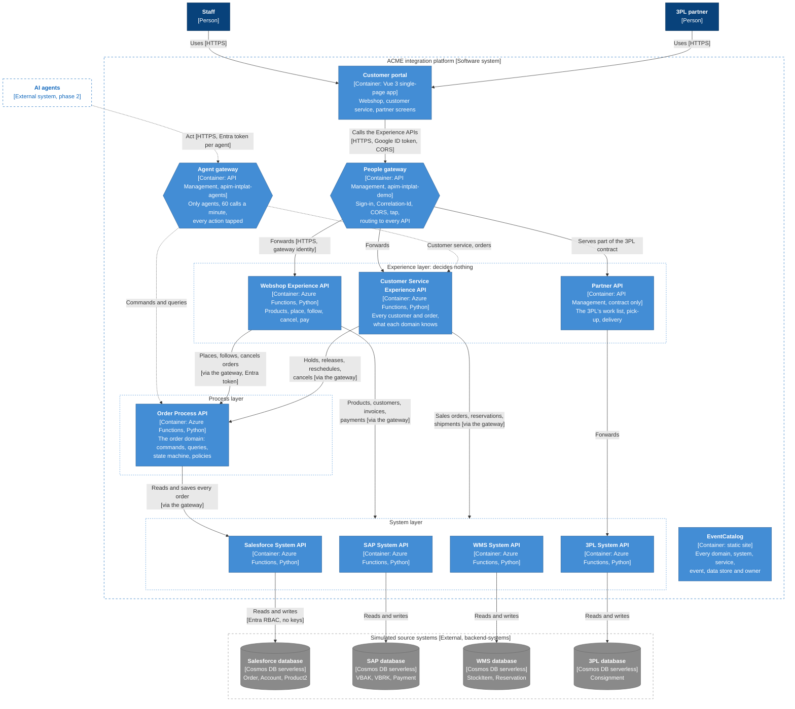
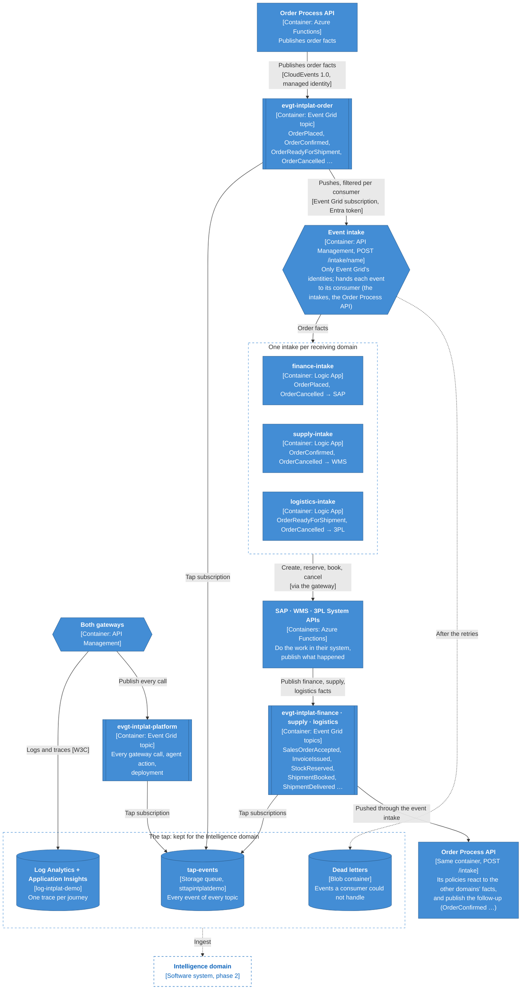
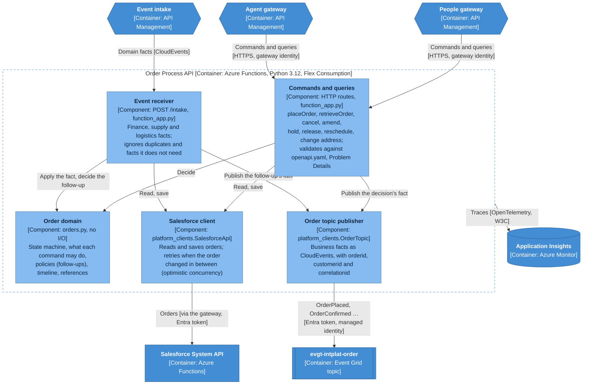
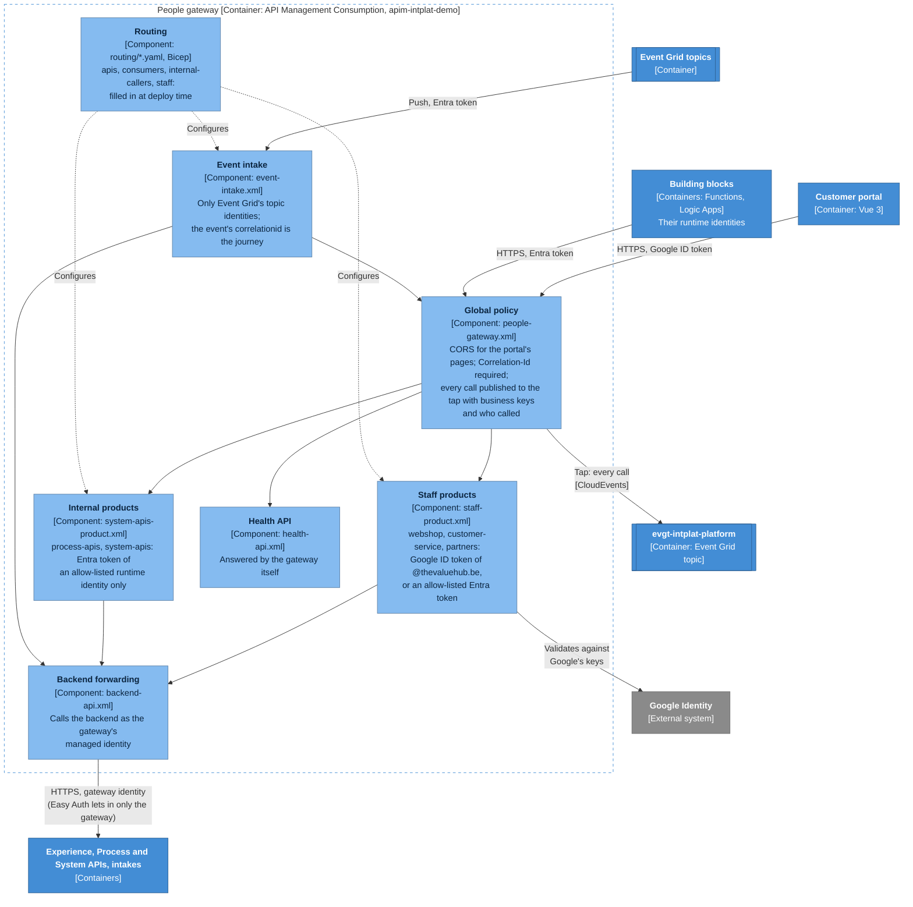
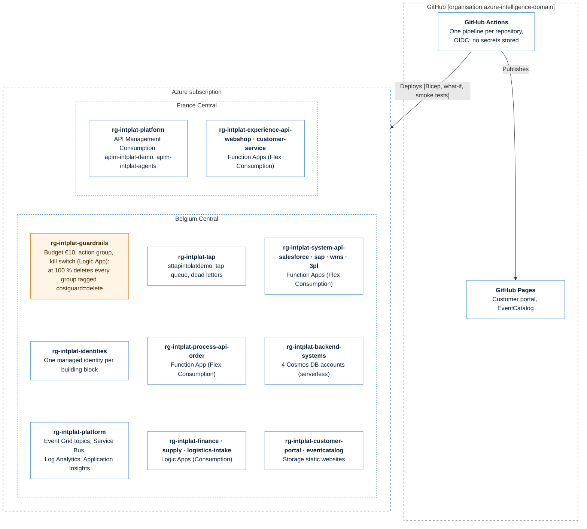

# C4 model

The architecture of the demo in the [C4 model](https://c4model.com/): from the people who use
it and the systems around it (level 1), to what runs where (level 2), to what is inside the
order domain and the gateway (level 3), and how it is deployed on Azure.

State: phase 1, step 7 (19 October 2026). Dashed elements are planned: AI agents and the
Intelligence domain come in phase 2.

| Level | View | Answers |
|---|---|---|
| 1 | [System context](#level-1--system-context) | Who uses the platform, and which systems does it connect? |
| 2 | [Containers: calls](#level-2--containers-calls) | What runs, and who calls whom? |
| 2 | [Containers: events and the tap](#level-2--containers-events-and-the-tap) | How do facts travel, and what is recorded? |
| 3 | [Components: Order Process API](#level-3--components-order-process-api) | How does the order domain decide? |
| 3 | [Components: people gateway](#level-3--components-people-gateway) | What does every call pass through? |
| — | [Deployment](#deployment) | Where does it run on Azure, and what does it cost? |
| — | [Elements](#elements) | Every container: technology, repository, owner |

Level 4 (code) is the code itself: each repository is small enough to read, and keeps its
`README.md` and contracts next to it.

**Notation.** The diagrams are Mermaid flowcharts in C4 notation and colours, so they render on
GitHub and in this repository's rules (`.md` diagrams are Mermaid). Every box shows its name,
its type and technology in brackets, and what it does. Every arrow says what flows and how.

| Colour | Element |
|---|---|
| Dark blue | Person |
| Blue | The software system in scope, or a container in it |
| Light blue | Component |
| Grey | External system (here: simulated, see [ADR 0007](../adr/0007-state-per-source-system.md)) |
| Dashed | Planned (phase 2) |

The generated counterpart is EventCatalog's
[System Context Diagram](https://azure-intelligence-domain.github.io/eventcatalog/visualiser/system-context-map)
and [architecture graph](https://azure-intelligence-domain.github.io/eventcatalog/visualiser/graph):
built from the released contracts and the Bicep, so they follow every release. This page
explains; the catalog is always current.

## Level 1 — System context

ACME's order-to-cash: an order is placed, confirmed by finance, reserved by the warehouse,
shipped by the 3PL partner and paid. The integration platform connects the systems that each do
one part, and records every hand-off for the Intelligence domain.

| Element | Why it is outside |
|---|---|
| Salesforce, SAP, WMS, 3PL | Systems ACME buys or a partner runs. Simulated in Cosmos DB, each in its own data model and naming, reachable only through its System API ([ADR 0007](../adr/0007-state-per-source-system.md)). Swapping a simulation for the real system changes one System API. |
| Google Identity | Staff sign in with their Google Workspace account; only `@thevaluehub.be` gets in ([ADR 0017](../adr/0017-experience-layer-and-staff-sign-in.md)). |
| Microsoft Entra ID | Every building block runs as its own managed identity; no keys or connection strings anywhere. |
| GitHub | One repository, one pipeline and one deploy identity per building block ([ADR 0006](../adr/0006-repository-per-ownership-boundary.md)). |

## Level 2 — Containers: calls

What runs inside the platform, and the calls between them. **Every call between building blocks
goes through the people gateway** (ground rule 1); the arrows marked *via the gateway* are drawn
directly, so the picture stays readable.

- **Experience APIs decide nothing.** They shape what the order domain and the System APIs say,
  for the people who use them ([ADR 0017](../adr/0017-experience-layer-and-staff-sign-in.md)).
  The Partner API has no code of its own: the gateway serves part of the 3PL contract.
- **The order domain decides.** Only the Order Process API changes an order; it keeps it in
  Salesforce ([ADR 0013](../adr/0013-order-domain.md), [0014](../adr/0014-process-layer-split.md)).
- **Nobody goes around the gateway.** Functions accept only the gateways' identities (Easy Auth);
  Process and System APIs accept only allow-listed runtime identities, never people.

## Level 2 — Containers: events and the tap

Hand-offs between domains are business facts (CloudEvents 1.0, past tense, with business keys and
a `correlationid`). Event Grid pushes each fact through the gateway's event intake to every
consumer in `routing/consumers.yaml` ([ADR 0016](../adr/0016-event-delivery-through-the-gateway.md)).
The tap records everything ([ADR 0011](../adr/0011-tap-by-default.md)).

- **Who receives what** is configuration, not code: `integration-platform/routing/consumers.yaml`.
  A new consumer is one entry; the platform creates its filtered subscriptions.
- **One intake per receiving domain** ([ADR 0015](../adr/0015-one-intake-per-domain.md)): the
  domain's team owns the mapping from order facts to its own system.
- **A cancellation reaches every domain** ([ADR 0018](../adr/0018-cancellation-reaches-every-domain.md)):
  each intake undoes its domain's part (credit note, stock released, booking cancelled).
- The Service Bus namespace `sbns-intplat-demo` exists without queues: kept for a consumer that
  needs ordered or pulled delivery (ADR 0016).

## Level 3 — Components: Order Process API

Inside `process-api-order` ([repository](https://github.com/azure-intelligence-domain/process-api-order)):
the domain logic is pure, and every input and output goes through the platform.

A command is: read the order (Salesforce client), let the order domain decide (allowed or
409 Order State Conflict), save it, publish the fact. A domain fact is: read the order, apply the
fact to its timeline and references, decide the follow-up (for example *confirmed* once SAP
accepted it), save, publish.

## Level 3 — Components: people gateway

Inside `apim-intplat-demo` ([integration-platform](https://github.com/azure-intelligence-domain/integration-platform)):
the gateway is configuration, not code. Its components are the policies every call passes
through, in this order.

Every refusal is Problem Details (RFC 9457) with a documented type: *Correlation Id Required*,
*Staff Sign-In Required*, *Platform Token Required*. The agent gateway (`apim-intplat-agents`)
has the same shape with its own global policy: an Entra token with the `Agent.Act` role for
every call, and 60 calls a minute per agent ([ADR 0012](../adr/0012-agent-gateway.md)).

## Deployment

One Azure subscription, consumption tiers only, a €10 monthly ceiling
([ADR 0003](../adr/0003-azure-consumption-with-cost-cap.md)). One resource group per building
block ([ADR 0006](../adr/0006-repository-per-ownership-boundary.md)); every group except the
guardrails is tagged `costguard=delete`, so the kill switch can remove it.

| Region | Why |
|---|---|
| Belgium Central | The default for everything. |
| France Central | API Management Consumption is not offered in Belgium Central. Since 17 October 2026 Belgium Central also refuses new App Service plans for this subscription (`429`), so the two Experience API Functions run next to the gateways ([ADR 0017](../adr/0017-experience-layer-and-staff-sign-in.md)). |

The tap (`rg-intplat-tap`) is never deleted by the kill switch; the Log Analytics daily cap is
0.15 GB. Month-to-date cost on 17 October 2026: €0.04.

## Elements

| Element | C4 type | Technology | Repository | Owner |
|---|---|---|---|---|
| Customer portal | Container | Vue 3, Vite; GitHub Pages + Storage static website | [customer-portal](https://github.com/azure-intelligence-domain/customer-portal) | Channel team |
| People gateway | Container | API Management Consumption (`apim-intplat-demo`) | [integration-platform](https://github.com/azure-intelligence-domain/integration-platform) | Platform team |
| Agent gateway | Container | API Management Consumption (`apim-intplat-agents`) | [integration-platform](https://github.com/azure-intelligence-domain/integration-platform) | Platform team |
| Event Grid topics | Container | Event Grid, CloudEvents 1.0, one per domain + platform | [integration-platform](https://github.com/azure-intelligence-domain/integration-platform) | Platform team |
| Tap | Container | Storage queue `tap-events`, blob container `deadletters` | [integration-platform](https://github.com/azure-intelligence-domain/integration-platform) | Platform team |
| Log Analytics, Application Insights | Container | Azure Monitor, `log-intplat-demo` | [integration-platform](https://github.com/azure-intelligence-domain/integration-platform) | Platform team |
| Webshop Experience API | Container | Azure Functions, Python 3.12 | [experience-api-webshop](https://github.com/azure-intelligence-domain/experience-api-webshop) | Channel team |
| Customer Service Experience API | Container | Azure Functions, Python 3.12 | [experience-api-customer-service](https://github.com/azure-intelligence-domain/experience-api-customer-service) | Channel team |
| Partner API | Container | API Management (contract only) | [experience-api-partner](https://github.com/azure-intelligence-domain/experience-api-partner) | Channel team |
| Order Process API | Container | Azure Functions, Python 3.12 | [process-api-order](https://github.com/azure-intelligence-domain/process-api-order) | Order team |
| finance-intake, supply-intake, logistics-intake | Container | Logic Apps (Consumption) | [finance-intake](https://github.com/azure-intelligence-domain/finance-intake), [supply-intake](https://github.com/azure-intelligence-domain/supply-intake), [logistics-intake](https://github.com/azure-intelligence-domain/logistics-intake) | Finance, supply, logistics teams |
| Salesforce, SAP, WMS, 3PL System APIs | Container | Azure Functions, Python 3.12 | [system-api-salesforce](https://github.com/azure-intelligence-domain/system-api-salesforce), [-sap](https://github.com/azure-intelligence-domain/system-api-sap), [-wms](https://github.com/azure-intelligence-domain/system-api-wms), [-3pl](https://github.com/azure-intelligence-domain/system-api-3pl) | Sales, finance, supply, logistics teams |
| Source system databases | External (simulated) | Cosmos DB serverless, one account per system | [backend-systems](https://github.com/azure-intelligence-domain/backend-systems) | Domain teams |
| EventCatalog | Container | EventCatalog static site, generated from contracts and Bicep | [eventcatalog](https://github.com/azure-intelligence-domain/eventcatalog) | Platform team |
| Guardrails | Deployment | Budget, action group, kill switch (Logic App) | [azure-landing-zone](https://github.com/azure-intelligence-domain/azure-landing-zone) | Platform team |
| Contracts and rules | — | Envelope schema, Spectral (adidas guidelines), contract check | [contracts](https://github.com/azure-intelligence-domain/contracts) | Platform team |

Update this page in the same change as the architecture it describes (as the
[solution design](README.md)).
