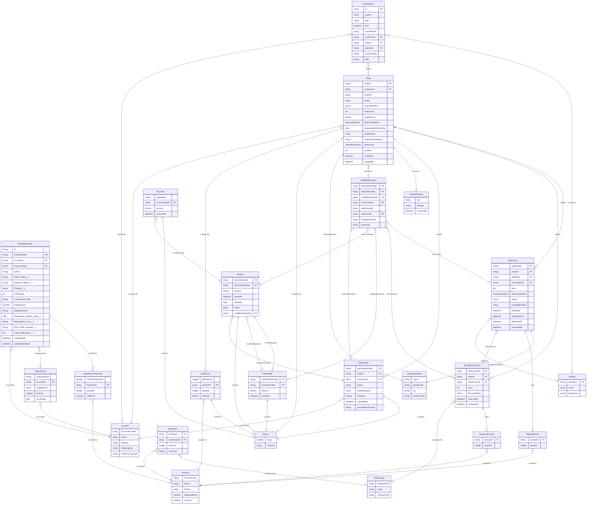
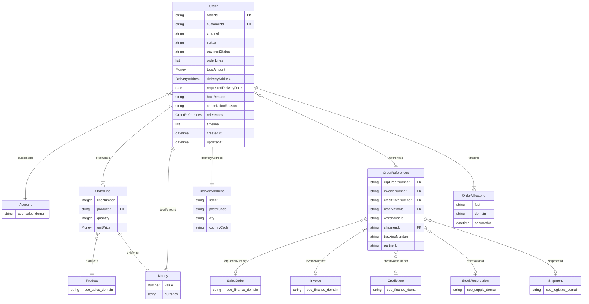
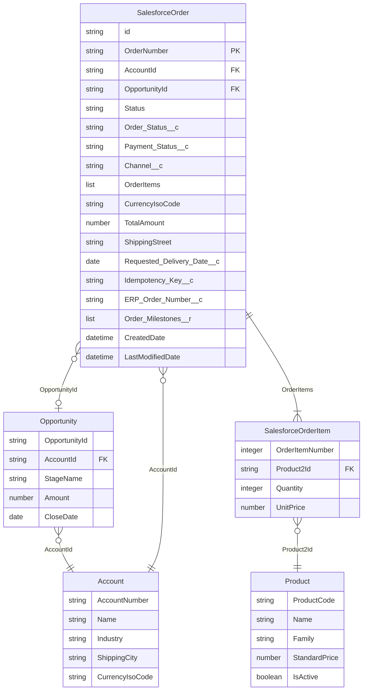
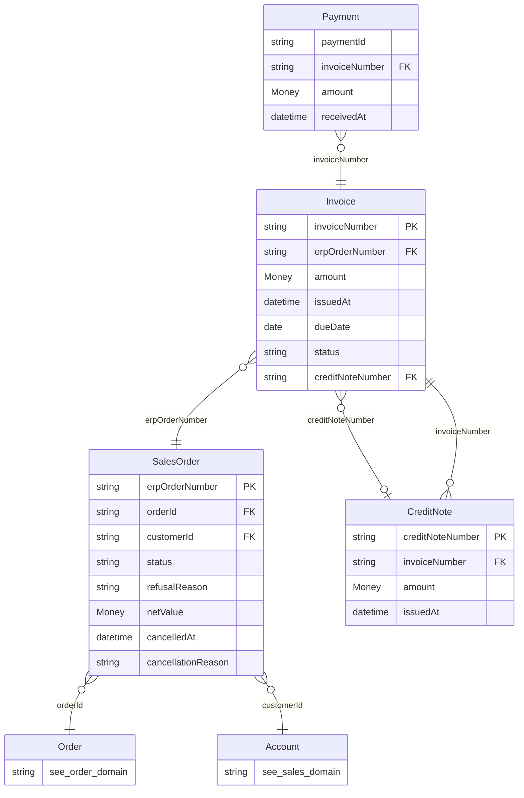
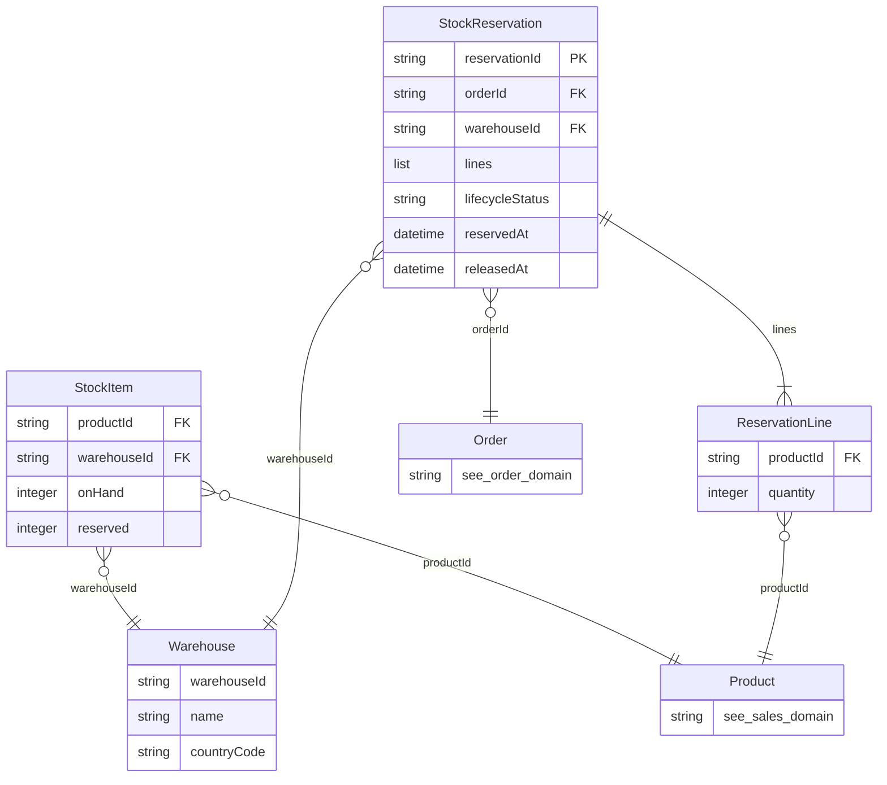
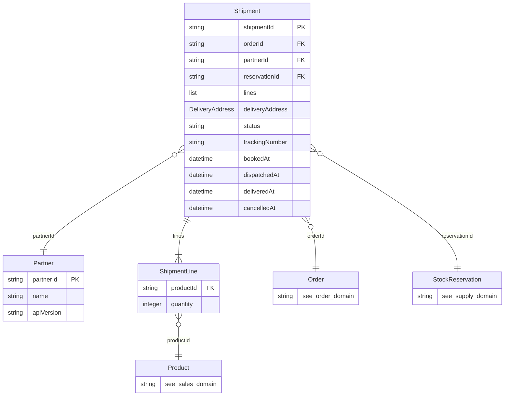
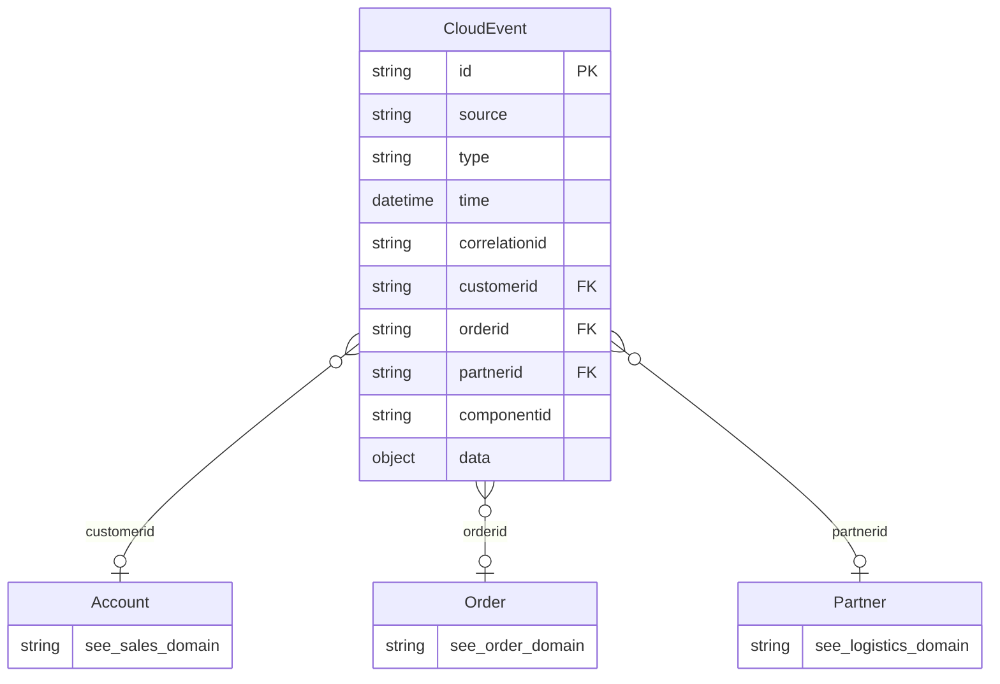

# Data models per domain

Each domain owns its model and names things in its own language; nobody shares a database. What
ties the models together are the **business keys** that every event carries (`customerid`,
`orderid`, `partnerid`): that is how the Intelligence domain can join the facts of every domain into
one story ("ACME's order 4711: placed, accepted by SAP, stock reserved, stuck at the 3PL").

| Domain | Kept in | Status | Catalog |
|---|---|---|---|
| Order | process-api-order 1.2.0 (references, timeline) | Built | [Order domain](https://azure-intelligence-domain.github.io/eventcatalog/docs/domains/order/1.0.0) |
| Sales | Salesforce (system of record) | Order, Account, Product simulated | [Sales domain](https://azure-intelligence-domain.github.io/eventcatalog/docs/domains/sales/1.0.0) |
| Finance | SAP | Built | [Finance domain](https://azure-intelligence-domain.github.io/eventcatalog/docs/domains/finance/1.0.0) |
| Supply | WMS | Built | [Supply domain](https://azure-intelligence-domain.github.io/eventcatalog/docs/domains/supply/1.0.0) |
| Logistics | 3PL partner | Built | [Logistics domain](https://azure-intelligence-domain.github.io/eventcatalog/docs/domains/logistics/1.0.0) |
| Platform | the envelope | Built |
| Channel | none: the Experience APIs show the other domains' data | Built (ADR 0017) | [Channel domain](https://azure-intelligence-domain.github.io/eventcatalog/docs/domains/channel/1.0.0) | [Platform domain](https://azure-intelligence-domain.github.io/eventcatalog/docs/domains/platform/1.0.0) |

The models are defined once in [`data_models.py`](data_models.py), which writes the Mermaid diagrams
below and the entities of EventCatalog:

```bash
uv run --no-project --with pyyaml python docs/architecture/data_models.py <out>   # then copy <out>/domains into eventcatalog
```

## All domains, joined by their keys



## Order



## Sales



## Finance



## Supply



## Logistics



## Platform


